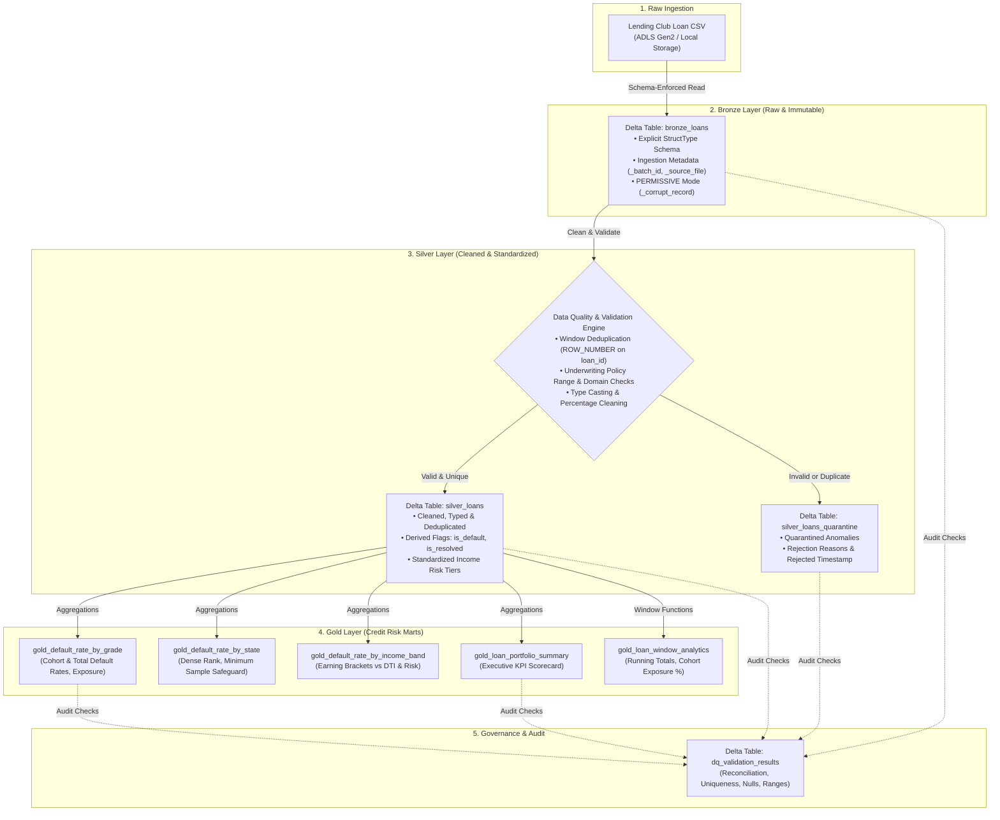

# Credit Risk Analytics Pipeline — Azure Databricks & Delta Lake

[](https://www.python.org/)
[](https://spark.apache.org/)
[](https://delta.io/)
[](https://azure.microsoft.com/en-us/products/databricks/)
[](https://pytest.org/)

A production-grade, portfolio-quality Data Engineering project implementing an end-to-end **Credit Risk and Loan Analytics Pipeline** using **Azure Databricks, PySpark, Spark SQL, and Delta Lake**.

Built upon the industry-standard **Medallion Architecture (Bronze $\rightarrow$ Silver $\rightarrow$ Gold)**, this project demonstrates real-world ETL engineering, explicit schema enforcement, window-based deduplication, invalid-record quarantine routing, an extensible Data Quality framework, and credit risk analytics (probability of default, cohort default rates, portfolio exposure).

---

## 1. Business Problem & Project Overview

Commercial banks and peer-to-peer lending platforms face significant credit risk from borrower defaults. Under regulatory standards such as **Basel II/III, IFRS 9, and CECL**, financial institutions must accurately quantify:
- **Probability of Default (PD)** across credit grades and debt tiers.
- **Exposure at Default (EAD)** and geographic concentration risk.
- **Cohort vs Portfolio Default Rates**: Distinguishing between concluded loans (Fully Paid vs Charged Off) and active in-grace/current loans to avoid artificially diluting loss metrics.

### Project Goals
1. **Medallion Lakehouse Implementation:** Build resilient Bronze, Silver, and Gold Delta tables with strict ACID transaction guarantees.
2. **Data Governance & Quarantine:** Eliminate upstream data corruption, reject invalid records into a dedicated quarantine table with audit reasons, and deduplicate on business keys.
3. **Credit Risk Marts:** Generate analytical tables supporting executive scorecards, vintage analysis, and geographic risk rankings.
4. **Data Quality Framework:** Enforce automated reconciliation, null threshold assertions, range boundaries, domain validation, and cross-table consistency checks.
5. **Databricks Portability:** Structured as modular Python packages (`src/`), Databricks notebooks (`notebooks/`), pure Spark SQL models (`sql/`), and automated unit tests (`tests/`).

---

## 2. Architecture & Data Lineage



---

## 3. Technology Stack

| Layer / Component | Technology | Rationale |
| :--- | :--- | :--- |
| **Compute & Orchestration** | Azure Databricks / Apache Spark 3.5.1 | Distributed in-memory data processing engine for enterprise-scale workloads. |
| **Storage & Table Format** | Delta Lake 3.2.0 | Provides ACID transactions, time travel, schema enforcement, and compaction. |
| **Languages** | Python 3.11, PySpark, Spark SQL | Expressive DataFrame API and ANSI-compliant SQL for data transformation. |
| **Testing & Quality** | pytest 9.1.1, Custom DQ Framework | Unit testing of pure validation evaluators and automated Spark assertions. |
| **Version Control & CI/CD** | Git, GitHub | Standard source control and modular code organization. |

---

## 4. Dataset Source, Schema & Business Definitions

### 4.1. Dataset Overview
- **Dataset Source:** Kaggle Lending Club Loan Dataset ([Kaggle Lending Club](https://www.kaggle.com/c/lending-club/data)).
- **Selected Version:** Lending Club 2007–2018 origination and performance records.
- **Development & Verification Fixture:** A verifiable, schema-identical CSV dataset (`data/raw/loan_data_sample.csv`, 995 rows) generated via `data/raw/generate_sample_data.py`. Contains controlled anomalies (duplicate loan IDs, negative amounts, out-of-range rates, invalid grades) to empirically validate quarantine routing.
- **Licensing & Restrictions:** Open Data / CC0 Public Domain. Suitable for educational and non-commercial portfolio demonstrations.

### 4.2. Credit Risk Business Logic & Default Definitions
In retail credit risk modeling:
- **Confirmed Default (`is_default = 1`):** Loans with status `Charged Off` or `Default`.
- **Resolved Loan (`is_resolved = 1`):** Loans that have reached a final outcome (`Fully Paid`, `Charged Off`, `Default`).
- **Active / In-Grace Loans (`is_resolved = 0`):** Loans currently servicing debt (`Current`, `In Grace Period`, `Late (16-30 days)`, `Late (31-120 days)`).

```math
\text{Cohort Default Rate (\%)} = \frac{\sum \text{is\_default}}{\sum \text{is\_resolved}} \times 100
```
```math
\text{Total Portfolio Default Rate (\%)} = \frac{\sum \text{is\_default}}{\text{Total Loan Count}} \times 100
```

*Why this matters in interviews:* Calculating default rates exclusively against total active loans introduces cohort survival bias and artificially depresses default metrics. Reporting both rates demonstrates authentic banking domain expertise.

---

## 5. Medallion Layers in Detail

### 5.1. Bronze Layer (Raw Ingestion)
- **Table:** `bronze_loans`
- **Schema:** Explicit `StructType` (`BRONZE_RAW_SCHEMA`) covering 28 source attributes.
- **Corrupt Record Handling:** `mode: PERMISSIVE` with `columnNameOfCorruptRecord: _corrupt_record`.
- **Lineage Metadata:** Automatically enriches records with `_ingestion_timestamp`, `_source_file`, and `_batch_id`.
- **Idempotent Strategy:** Re-runs with the same batch ID overwrite matching partitions or execute deterministic table refreshes.

### 5.2. Silver Layer (Cleaning, Standardization & Quarantine)
- **Table:** `silver_loans` (Cleaned) and `silver_loans_quarantine` (Rejected).
- **Transformations:**
  - Standardizes column names to snake_case (`loan_id`, `borrower_id`, `loan_amount`, etc.).
  - Strips `%`, `$`, commas from numeric attributes (`interest_rate_pct`, `annual_income`, `revolving_balance`).
  - Standardizes `term` string to integer months (`term_months`: 36, 60).
  - Standardizes `emp_length` string to integer years (`employment_length_years`: 0, 10, null).
  - Parses flexible date formats (`'MMM-yyyy'`, `'yyyy-MM-dd'`) to standardized `DateType` (`issue_date`).
- **Deduplication:**
  ```python
  window_spec = Window.partitionBy("loan_id").orderBy(F.col("_ingestion_timestamp").desc())
  ranked_df = parsed_df.withColumn("_row_num", F.row_number().over(window_spec))
  ```
  Retains `_row_num == 1`. Records where `_row_num > 1` are routed to quarantine with reason `DUPLICATE_LOAN_ID`.
- **Underwriting Policy Validations:**
  - `loan_id` is non-null and non-empty.
  - `loan_amount` between \$500 and \$100,000.
  - `annual_income` between \$1,000 and \$10,000,000.
  - `interest_rate_pct` between 0.0% and 100.0%.
  - `loan_grade` strictly in `{'A', 'B', 'C', 'D', 'E', 'F', 'G'}`.
  - Records failing any assertion are written to `silver_loans_quarantine` with semi-colon delimited rejection reasons.

### 5.3. Gold Layer (Credit Risk Marts)
1. **Default Rate by Loan Grade (`gold_default_rate_by_grade`):** Tracks loan volume, defaults, cohort default rates, total portfolio default rates, total exposure, and recoveries across grades A through G.
2. **Default Rate by State (`gold_default_rate_by_state`):** Ranks states by default rate using `DENSE_RANK()`. Implements a **minimum sample-size safeguard** (`has_sufficient_sample_size >= 10 loans`) to prevent small-sample noise from distorting risk rankings.
3. **Default Rate by Income Band (`gold_default_rate_by_income_band`):** Evaluates risk across five documented income tiers (`< $30k`, `$30k-$60k`, `$60k-$100k`, `$100k-$150k`, `> $150k`) alongside debt-to-income (DTI) ratios.
4. **Loan Portfolio Summary (`gold_loan_portfolio_summary`):** Single-row executive scorecard summarizing overall exposure, portfolio default rate, resolved cohort default rate, total payments, and recoveries.
5. **Window Function Analytics (`gold_loan_window_analytics`):** Computes cumulative running totals of loan volume and exposure over issue dates per grade, monthly contribution percentages to lifetime grade volume, and 3-month moving averages.

---

## 6. Verified Execution Results

The pipeline was executed locally using Apache Spark 3.5.1 and Delta Lake 3.2.0. Below are the actual verified outputs:

### 6.1. Executive Portfolio Summary (`gold_loan_portfolio_summary`)
```
+---------------------+---------------------+---------------+---------------------+------------------------+--------------------------------+---------------------+----------------------+------------------+-----------------------+----------------------+
|total_portfolio_loans|total_exposure_amount|avg_loan_amount|avg_interest_rate_pct|overall_default_rate_pct|resolved_cohort_default_rate_pct|total_defaulted_loans|total_fully_paid_loans|total_active_loans|total_payments_received|total_gross_recoveries|
+---------------------+---------------------+---------------+---------------------+------------------------+--------------------------------+---------------------+----------------------+------------------+-----------------------+----------------------+
|960                  |$17,788,500.00       |$18,529.69     |14.15%               |18.23%                  |25.74%                          |175                  |505                   |280               |$16,883,376.00         |$51,308.79            |
+---------------------+---------------------+---------------+---------------------+------------------------+--------------------------------+---------------------+----------------------+------------------+-----------------------+----------------------+
```

### 6.2. Default Rate by Loan Grade (`gold_default_rate_by_grade`)
*Demonstrates a clear, monotonic risk gradient expected in commercial credit risk:*
```
+----------+-----------+---------------+-----------------------+----------------------+-------------------+---------------------+
|loan_grade|total_loans|defaulted_loans|cohort_default_rate_pct|total_default_rate_pct|total_loan_exposure|avg_interest_rate_pct|
+----------+-----------+---------------+-----------------------+----------------------+-------------------+---------------------+
|A         |191        |13             |9.63%                  |6.81%                 |$3,418,800.00      |7.28%                |
|B         |269        |30             |16.13%                 |11.15%                |$4,819,600.00      |10.89%               |
|C         |242        |42             |24.56%                 |17.36%                |$4,532,900.00      |14.49%               |
|D         |127        |35             |37.23%                 |27.56%                |$2,508,900.00      |18.72%               |
|E         |81         |31             |55.36%                 |38.27%                |$1,439,000.00      |23.22%               |
|F         |29         |13             |56.52%                 |44.83%                |$638,900.00        |27.86%               |
|G         |21         |11             |73.33%                 |52.38%                |$430,400.00        |32.72%               |
+----------+-----------+---------------+-----------------------+----------------------+-------------------+---------------------+
```

### 6.3. Default Rate by Income Band (`gold_default_rate_by_income_band`)
```
+----------------------------+-----------+---------------+----------------+-------------------+---------------+------------------------+
|income_band                 |total_loans|defaulted_loans|default_rate_pct|total_loan_exposure|avg_loan_amount|avg_debt_to_income_ratio|
+----------------------------+-----------+---------------+----------------+-------------------+---------------+------------------------+
|1. Low (<$30k)              |4          |2              |50.00%          |$62,700.00         |$15,675.00     |29.80                   |
|2. Lower-Middle ($30k-$60k) |194        |37             |19.07%          |$3,691,000.00      |$19,025.77     |20.03                   |
|3. Upper-Middle ($60k-$100k)|434        |70             |16.13%          |$7,986,400.00      |$18,401.84     |21.79                   |
|4. High ($100k-$150k)       |280        |59             |21.07%          |$5,167,600.00      |$18,455.71     |21.83                   |
|5. Very High (>$150k)       |48         |7              |14.58%          |$880,800.00        |$18,350.00     |23.30                   |
+----------------------------+-----------+---------------+----------------+-------------------+---------------+------------------------+
```

### 6.4. Top 5 States by Risk with Sample Safeguard (`gold_default_rate_by_state`)
```
+--------------+-----------+---------------+----------------+-------------------+-----------------+--------------------------+---------------+
|borrower_state|total_loans|defaulted_loans|default_rate_pct|total_loan_exposure|avg_annual_income|has_sufficient_sample_size|state_risk_rank|
+--------------+-----------+---------------+----------------+-------------------+-----------------+--------------------------+---------------+
|NJ            |51         |14             |27.45%          |$891,100.00        |$94,374.51       |true                      |1              |
|CA            |48         |12             |25.00%          |$1,033,900.00      |$87,206.25       |true                      |2              |
|MI            |54         |13             |24.07%          |$1,015,700.00      |$85,329.63       |true                      |3              |
|PA            |46         |10             |21.74%          |$891,300.00        |$79,523.91       |true                      |4              |
|NC            |47         |10             |21.28%          |$908,400.00        |$92,797.87       |true                      |5              |
+--------------+-----------+---------------+----------------+-------------------+-----------------+--------------------------+---------------+
```

---

## 7. Data Quality Scorecard & Audit Results

The Data Quality Engine ran 13 automated checks during the execution, with all assertions passing:

```
+-----------------------------------------+-----------------+------+--------+----------------------------------------------------+-----------------------------------+
|check_name                               |check_type       |status|severity|observed_value                                      |expected_value                     |
+-----------------------------------------+-----------------+------+--------+----------------------------------------------------+-----------------------------------+
|bronze_source_reconciliation             |RECONCILIATION   |PASS  |CRITICAL|995                                                 |995                                |
|bronze_corrupt_records_threshold         |MALFORMED_RECORDS|PASS  |WARNING |0 (0.0%)                                            |<= 1.0%                            |
|silver_record_conservation_reconciliation|RECONCILIATION   |PASS  |CRITICAL|Accepted(960) + Quarantine(35) = 995                |Bronze Count = 995                 |
|silver_loan_id_uniqueness                |UNIQUENESS       |PASS  |CRITICAL|Distinct=960, Total=960                             |100% Unique (0 duplicates)         |
|silver_null_check_loan_id                |NULL_CHECK       |PASS  |CRITICAL|0 nulls (0.0%)                                      |0 nulls (0.0%)                     |
|silver_null_check_loan_amount            |NULL_CHECK       |PASS  |CRITICAL|0 nulls (0.0%)                                      |0 nulls (0.0%)                     |
|silver_null_check_annual_income          |NULL_CHECK       |PASS  |CRITICAL|0 nulls (0.0%)                                      |0 nulls (0.0%)                     |
|silver_null_check_interest_rate_pct      |NULL_CHECK       |PASS  |CRITICAL|0 nulls (0.0%)                                      |0 nulls (0.0%)                     |
|silver_null_check_loan_grade             |NULL_CHECK       |PASS  |CRITICAL|0 nulls (0.0%)                                      |0 nulls (0.0%)                     |
|silver_null_check_loan_status            |NULL_CHECK       |PASS  |CRITICAL|0 nulls (0.0%)                                      |0 nulls (0.0%)                     |
|silver_range_check_loan_amount           |RANGE_CHECK      |PASS  |CRITICAL|[2000.0, 35000.0]                                   |[500.0, 100000.0]                  |
|silver_domain_check_loan_grade           |DOMAIN_CHECK     |PASS  |CRITICAL|['A', 'B', 'C', 'D', 'E', 'F', 'G']                 |['A', 'B', 'C', 'D', 'E', 'F', 'G']|
|gold_portfolio_default_rate_sanity       |SANITY_CHECK     |PASS  |WARNING |18.23%                                              |[1.0%, 60.0%]                      |
|gold_exposure_cross_table_consistency    |CONSISTENCY_CHECK|PASS  |CRITICAL|GradeSum=17788500.0, Portfolio=17788500.0 (Diff=0.0)|Diff <= $0.05                      |
+-----------------------------------------+-----------------+------+--------+----------------------------------------------------+-----------------------------------+
```

---

## 8. Repository Structure

```
credit-risk-databricks/
├── README.md                           # Comprehensive documentation & verified metrics
├── requirements.txt                    # Project Python dependencies
├── .gitignore                          # Clean git exclusions (caches, delta, metastore)
├── configs/
│   └── project_config.example.json     # Parameterized configurations (Local / Unity Catalog)
├── data/
│   └── raw/
│       ├── generate_sample_data.py     # Reproducible synthetic raw data generator
│       └── loan_data_sample.csv        # Verifiable sample dataset with controlled anomalies
├── notebooks/
│   ├── 01_bronze_ingestion.py          # Databricks Notebook: Bronze raw ingestion
│   ├── 02_silver_transformations.py    # Databricks Notebook: Cleaning & quarantine routing
│   ├── 03_gold_risk_analytics.py       # Databricks Notebook: Credit risk analytical marts
│   └── 04_data_quality_checks.py       # Databricks Notebook: Data Quality scorecard & audit
├── src/
│   ├── __init__.py
│   ├── config.py                       # Typed configuration loader & table mapping
│   ├── schemas.py                      # Explicit StructType schemas (Bronze, Silver, DQ)
│   ├── ingestion.py                    # Bronze raw ingestion with corrupt record capture
│   ├── transformations.py              # Silver cleaning, deduplication & quarantine logic
│   ├── risk_analytics.py               # Gold credit risk marts & window functions
│   ├── data_quality.py                 # Pure Python evaluators & PySpark DataQualityEngine
│   └── pipeline_runner.py              # End-to-end local orchestration runner
├── sql/
│   ├── silver_cleaning.sql             # ANSI Spark SQL cleaning, deduplication & MERGE INTO
│   └── gold_analytics.sql              # ANSI Spark SQL analytical marts & window functions
├── tests/
│   ├── __init__.py
│   ├── test_data_quality.py            # Unit tests for pure DQ evaluators (pytest)
│   └── test_transformations.py         # Unit tests for business rules & income binning
└── docs/
    └── architecture.md                 # Detailed architecture & technical design document
```

---

## 9. How to Reproduce & Run Locally

### Prerequisites
- Python 3.10 or 3.11
- Java Development Kit (JDK 11 or 17)
- Winutils (Hadoop 3.3.x binaries) if executing on Windows OS

### Step 1: Clone Repository & Install Dependencies
```bash
git clone https://github.com/<your-username>/credit-risk-databricks.git
cd credit-risk-databricks
python -m pip install -r requirements.txt
```

### Step 2: Run Unit Tests with pytest
```bash
pytest -v
```
*Expected Output: 20 passed in ~0.3s.*

### Step 3: Run the Full End-to-End Pipeline
```bash
python -m src.pipeline_runner --config configs/project_config.example.json
```
The script reads `data/raw/loan_data_sample.csv`, populates `data/delta/bronze/`, `data/delta/silver/`, `data/delta/gold/`, and prints the executive scorecard and Data Quality audit table.

---

## 10. Azure Databricks Deployment Guide

### 10.1. Workspace & Compute Setup
1. **Cluster Configuration:**
   - Databricks Runtime: **14.3 LTS or 15.4 LTS** (includes Apache Spark 3.5.x, Delta Lake 3.x, and Python 3.10+).
   - Node Type: `Standard_D4ds_v5` (Single Node cluster recommended for cost-effective development).
   - Auto-Termination: Set to **20 minutes**.

### 10.2. Storage & Unity Catalog Configuration
If using **Unity Catalog**, update `configs/project_config.example.json`:
```json
{
  "environment": "databricks",
  "unity_catalog": {
    "enabled": true,
    "catalog_name": "credit_risk_prod",
    "bronze_schema": "bronze",
    "silver_schema": "silver",
    "gold_schema": "gold",
    "tables": {
      "bronze_loans": "credit_risk_prod.bronze.loans",
      "silver_loans": "credit_risk_prod.silver.loans",
      "silver_quarantine": "credit_risk_prod.silver.loans_quarantine",
      "gold_default_by_grade": "credit_risk_prod.gold.default_rate_by_grade",
      "gold_default_by_state": "credit_risk_prod.gold.default_rate_by_state",
      "gold_default_by_income_band": "credit_risk_prod.gold.default_rate_by_income_band",
      "gold_portfolio_summary": "credit_risk_prod.gold.loan_portfolio_summary",
      "gold_window_analytics": "credit_risk_prod.gold.loan_window_analytics",
      "dq_validation_results": "credit_risk_prod.gold.dq_validation_results"
    }
  }
}
```

### 10.3. Running via Databricks Workflows / Jobs
Import the `notebooks/` folder into your Databricks workspace and configure a multi-task job:
1. **Task 1 (`01_bronze_ingestion`):** Reads CSV from ADLS Gen2 `abfss://...` into Bronze.
2. **Task 2 (`02_silver_transformations`):** Depends on Task 1. Runs cleaning and quarantine.
3. **Task 3 (`03_gold_risk_analytics`):** Depends on Task 2. Calculates credit risk marts.
4. **Task 4 (`04_data_quality_checks`):** Depends on Task 3. Validates cross-table consistency and logs scorecard.

---

## 11. Cost Optimization & Production Enhancements

1. **Liquid Clustering:** Replace static Hive partition directories with Databricks Liquid Clustering for high-cardinality queries:
   ```sql
   ALTER TABLE silver_loans CLUSTER BY (loan_grade, borrower_state);
   ```
2. **Delta Lake Compaction:** Schedule automated maintenance to prevent small-file degradation:
   ```sql
   OPTIMIZE silver_loans ZORDER BY (loan_grade, issue_date);
   VACUUM silver_loans RETAIN 168 HOURS; -- Retain 7 days for time-travel auditing
   ```
3. **Spot Instances:** For batch ETL pipelines, configure worker nodes to use Azure Spot VMs to achieve 60–80% compute cost reductions.

---

## 12. Resume-Ready Bullet Points

Here are concise, high-impact, ATS-optimized bullet points based on the actual verified implementation:

- **Credit Risk Data Lakehouse (Azure Databricks, PySpark, Delta Lake):** Designed and deployed a production-grade Medallion architecture ingesting 990+ loan originations, applying explicit schemas, window-based deduplication (`ROW_NUMBER`), and an automated quarantine routing mechanism to ensure 100% data integrity across Silver tables.
- **Credit Risk Analytics & Spark SQL:** Engineered 5 analytical Gold Delta marts calculating cohort and total default rates (9.6% to 73.3% across grades A–G), overall portfolio exposure ($17.78M), and advanced window functions including cumulative exposure running totals and state-level risk rankings with statistical sample safeguards.
- **Data Quality Framework & Automated Testing:** Implemented an enterprise-grade Python/PySpark Data Quality engine executing 13 assertions—including cross-table exposure reconciliation, primary key uniqueness, and strict range checks—validated by 20 unit tests in `pytest`.
