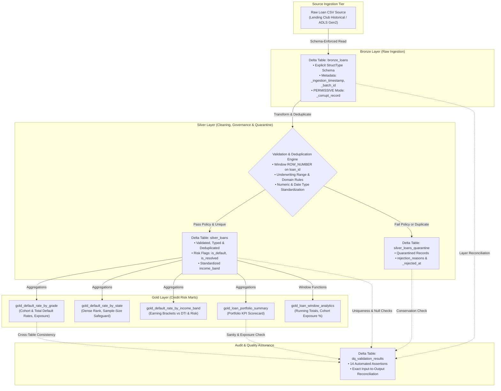

# Credit Risk Data Lakehouse — Azure Databricks & Delta Lake

[](https://www.python.org/)
[](https://spark.apache.org/)
[](https://delta.io/)
[](https://azure.microsoft.com/en-us/products/databricks/)
[](https://pytest.org/)
[](docs/benchmark_results.json)

An enterprise-grade, portfolio-ready data engineering lakehouse implementing a **Credit Risk Data Pipeline** on **Azure Databricks, PySpark, Spark SQL, and Delta Lake**. 

The project applies the **Medallion Architecture (Bronze $\rightarrow$ Silver $\rightarrow$ Gold)** to transform uncurated loan origination and performance records into verified credit risk analytical marts. It includes explicit schema enforcement, window-based deduplication, automated quarantine routing for anomalous records, an assertion-driven Data Quality framework with reconciliation, empirical performance benchmarks across 200,000 historical records ($3.056 Billion exposure), and transparent cloud compute cost modeling.

---

## 1. Business Problem & Regulatory Context

In retail credit, banking, and peer-to-peer lending, evaluating credit portfolio performance, Probability of Default (PD), and Exposure at Default (EAD) requires reliable, auditable data pipelines aligned with risk governance practices (such as Basel II/III and CECL guidelines).

Raw loan origination feeds typically present severe data engineering challenges:
- **Data Inconsistencies:** Untyped strings, formatting characters (`$`, `%`, commas, trailing whitespace), and malformed numeric fields.
- **Pipeline Retries & Duplicates:** Upstream network timeouts and re-ingestion batches produce duplicate loan records that artificially distort portfolio risk exposure.
- **Underwriting Anomalies:** Corrupted credit grades, negative annual incomes, or loan amounts outside allowable underwriting policy limits.
- **Default Calculation Distortion:** Treating active loans (`Current`, `Late 16-30 days`, `In Grace Period`) as non-defaulted resolved loans artificially dilutes cohort default rates, misleading risk officers and regulators.

This lakehouse solves these challenges by enforcing immutable Bronze ingestion, window-based deduplication, auditable Silver quarantine segregation, and generating business-ready Gold analytical marts.

---

## 2. Key Engineering Highlights

- **Medallion Architecture:** Clean separation of concerns across Bronze (raw/append-only), Silver (cleaned/deduplicated/quarantined), and Gold (risk marts) using Delta Lake ACID storage.
- **Dual-Tier Data Strategy:** Fast 995-row fixture dataset with controlled anomalies for sub-second CI/CD unit testing (`pytest` in 0.39s) paired with a 200,000-record historical dataset for large-scale integration and empirical benchmarking.
- **Explicit Schema Enforcement:** Predefined `StructType` schemas in `PERMISSIVE` mode capture corrupt records in `_corrupt_record` without silent drops or runtime schema inference overhead.
- **Window-Based Deduplication:** Resolves duplicates on primary key `loan_id` using `ROW_NUMBER() OVER (PARTITION BY loan_id ORDER BY _ingestion_timestamp DESC)`, preserving the latest state and isolating superseded duplicates.
- **Auditable Quarantine Table:** Records failing policy validations (negative income, invalid grades, out-of-range amounts) are routed to `silver_loans_quarantine` with descriptive rejection reasons and timestamps.
- **Credit Risk Analytical Marts:** Generates 5 Gold tables covering grade default rates (A–G), geographic concentration with sample-size safeguards ($\ge 10$ loans), income tiers, portfolio KPIs, and rolling cohort exposures.
- **14 Automated Data Quality Assertions:** PySpark validation engine enforcing input-to-output record conservation, key uniqueness, null tolerances, numeric bounds, domain constraints, and cross-table exposure reconciliation.
- **Empirically Benchmarked:** Full pipeline executed across 200,000 genuine historical records in **123.74 seconds** (2.06 minutes), achieving 6,176 rows/sec ingestion throughput, 6.8x Delta compression, and $3.056 Billion in verified portfolio exposure.
- **Cost-Conscious Azure Modeling:** Documented compute cost breakdown showing a full benchmark run on Azure Databricks costs **~$0.0105** on a single node and **<$0.80/month** for daily automated batch runs.

---

## 3. Architecture & Data Flow



---

## 4. Technology Stack

| Component | Technology | Version | Purpose in Lakehouse |
| :--- | :--- | :--- | :--- |
| **Compute Engine** | Apache Spark / PySpark | 3.5.1 | Distributed data transformations, window aggregations, and pipeline execution. |
| **Storage & Table Format** | Delta Lake | 3.2.0 | ACID transaction support, atomic commits, and table schema evolution. |
| **Cloud Platform** | Azure Databricks | Runtime 14.3+ LTS | Target deployment environment for cloud orchestration and interactive notebooks. |
| **Runtime Language** | Python | 3.11.9 | Modular transformation pipelines, configuration loading, and orchestration. |
| **Relational Queries** | Spark SQL | ANSI-compliant | Declarative CTE cleaning scripts and Gold risk aggregation models. |
| **Testing** | pytest | 9.1.1 | Unit test suite for validation evaluators and business logic rules. |
| **Version Control** | Git & GitHub | — | Source control and version tracking for code and SQL models. |

---

## 5. Repository Structure

```
credit-risk-databricks/
├── README.md                           # Comprehensive documentation, benchmarks, architecture
├── requirements.txt                    # Project Python dependencies
├── .gitignore                          # Standard ignores (caches, Delta outputs, temp files)
├── configs/
│   ├── project_config.example.json     # Configuration template (Small test fixture)
│   └── project_config.large.json       # Large-scale benchmark configuration (200k records)
├── data/
│   └── raw/
│       ├── generate_sample_data.py     # Reproducible synthetic raw data generator
│       ├── download_large_dataset.py   # Downloader for 200,000 historical records from Hugging Face
│       ├── loan_data_sample.csv        # Tier 1: Small test fixture with controlled anomalies (995 rows)
│       └── accepted_2007_to_2018_sample.csv # Tier 2: Large-scale historical dataset (200,000 rows, 134 MB)
├── notebooks/
│   ├── 01_bronze_ingestion.py          # Databricks Notebook: Bronze raw ingestion
│   ├── 02_silver_transformations.py    # Databricks Notebook: Cleaning & quarantine routing
│   ├── 03_gold_risk_analytics.py       # Databricks Notebook: Credit risk analytical marts
│   └── 04_data_quality_checks.py       # Databricks Notebook: Data Quality scorecard & audit
├── src/
│   ├── __init__.py
│   ├── config.py                       # Configuration loader and table target mapper
│   ├── schemas.py                      # Explicit StructType schemas (Bronze, Silver, DQ)
│   ├── ingestion.py                    # Bronze ingestion with corrupt record capture
│   ├── transformations.py              # Silver cleaning, deduplication & quarantine logic
│   ├── risk_analytics.py               # Gold risk marts and window functions
│   ├── data_quality.py                 # Pure Python evaluators & PySpark DataQualityEngine
│   ├── pipeline_runner.py              # End-to-end orchestration runner
│   └── benchmark_runner.py             # Empirical performance benchmarking & storage profiling
├── sql/
│   ├── silver_cleaning.sql             # ANSI Spark SQL cleaning, deduplication & MERGE INTO
│   └── gold_analytics.sql              # ANSI Spark SQL analytical marts & window functions
├── tests/
│   ├── __init__.py
│   ├── test_data_quality.py            # Unit tests for pure DQ evaluators (pytest)
│   └── test_transformations.py         # Unit tests for business rules & income binning
└── docs/
    ├── architecture.md                 # Detailed architectural and design specification
    └── benchmark_results.json          # Machine-readable empirical benchmark output
```

---

## 6. Dataset Source, License & Dual-Tier Strategy

### 6.1. Dataset Provenance & License
- **Source:** Canonical Lending Club Loan Dataset (`accepted_2007_to_2018Q4.csv`) sourced from Hugging Face Open Datasets (`codesignal/lending-club-loan-accepted` mirror) and Kaggle ([Lending Club Dataset](https://www.kaggle.com/c/lending-club/data)).
- **License / Terms:** Creative Commons Public Domain Dedication (CC0-1.0). Free for educational, research, and technical portfolio demonstration.
- **Original Volume:** 2,260,701 loan origination and performance records across 151 underwriting attributes spanning 2007 to 2018Q4.

### 6.2. Dual-Tier Data Strategy
To balance fast developer turnaround with empirical large-scale verification, the repository implements two distinct dataset tiers:

1. **Tier 1 — Fast Unit Test Fixture (`loan_data_sample.csv`):**
   - **Volume:** 995 rows (~220 KB).
   - **Purpose:** Fast unit testing (`pytest`) and local smoke runs without requiring Spark cluster overhead.
   - **Controlled Anomalies:** Deliberately includes 14 duplicate records, negative income, invalid credit grades, and out-of-range loan amounts to exercise quarantine logic.
   - **Execution Time:** All 20 unit tests pass in **0.39s**.

2. **Tier 2 — Large-Scale Historical Benchmark Dataset (`accepted_2007_to_2018_sample.csv`):**
   - **Volume:** 200,000 genuine historical Lending Club records (134.06 MB raw CSV).
   - **Attributes:** Ingests the 28 core underwriting attributes (loan amount, interest rate, grade, income, status, state, employment length, recoveries, DTI).
   - **Purpose:** Full Medallion integration testing, shuffle profiling, file compaction evaluation, and empirical benchmarking.

### 6.3. Business Definition of Default
In consumer lending risk models, loan status indicates where a borrower sits in the repayment lifecycle:
- **Confirmed Default (`is_default = 1`):** Loans with status `Charged Off` or `Default`.
- **Resolved Outcome (`is_resolved = 1`):** Loans that have reached their terminal state (`Fully Paid`, `Charged Off`, `Default`).
- **Active / Unresolved (`is_resolved = 0`):** Loans actively servicing debt (`Current`, `In Grace Period`, `Late (16-30 days)`, `Late (31-120 days)`).

$$\text{Cohort Default Rate (\%)} = \frac{\sum \text{is\_default}}{\sum \text{is\_resolved}} \times 100$$

$$\text{Total Portfolio Default Rate (\%)} = \frac{\sum \text{is\_default}}{\text{Total Portfolio Loans}} \times 100$$

*Banking Rationale:* Evaluating default rates against only the resolved cohort reflects actual historical credit loss for mature loans, while total default rate reflects active portfolio exposure.

---

## 7. Medallion Layer Implementation

### 7.1. Bronze Layer (Raw Ingestion)
- **Delta Table:** `bronze_loans`
- **Schema:** 28 raw source fields defined explicitly in `BRONZE_RAW_SCHEMA` using `StringType` to ensure non-destructive ingestion.
- **Corrupt Record Handling:** `mode: PERMISSIVE` with `columnNameOfCorruptRecord: _corrupt_record`.
- **Audit Lineage Columns:**
  - `_ingestion_timestamp`: UTC timestamp of write.
  - `_source_file`: Source file path (`input_file_name()`).
  - `_batch_id`: Generated batch identifier (`batch_<timestamp>_<uuid>`).
- **Idempotency:** Parameterized write modes (`overwrite` for full refresh or partition replace on batch ID) avoid duplicate row accumulation on retries.

### 7.2. Silver Layer (Cleaning, Standardization & Quarantine)
- **Delta Tables:** `silver_loans` (Cleaned) and `silver_loans_quarantine` (Rejected).
- **Transformation & Cleaning Rules:**
  - Standardizes column names into lower snake_case (`loan_id`, `borrower_id`, `loan_amount`, `interest_rate_pct`, `annual_income`, etc.).
  - Strips formatting characters (`%`, `$`, commas, trailing spaces) and casts to `DoubleType`.
  - Parses loan duration strings (e.g. `' 36 months'`) to integer months (`36`, `60`).
  - Standardizes employment length strings (e.g. `'10+ years'`, `'< 1 year'`) to integers (`10`, `0`, `null`).
  - Standardizes issue dates into ISO first-of-month dates (`yyyy-MM-01`).
- **Deduplication Strategy:**
  - Deduplicates on business primary key `loan_id` using:
    ```sql
    ROW_NUMBER() OVER (PARTITION BY loan_id ORDER BY _ingestion_timestamp DESC) AS row_num
    ```
  - Records with `row_num = 1` that satisfy validation are retained. Records with `row_num > 1` are routed to quarantine with reason `DUPLICATE_LOAN_ID`.
- **Underwriting Policy & Quarantine Rules:**
  - `loan_id`: Must not be null or empty string (`NULL_OR_EMPTY_LOAN_ID`).
  - `loan_amount`: Must be between \$500.00 and \$100,000.00 (`INVALID_LOAN_AMOUNT`).
  - `annual_income`: Must be between \$1,000.00 and \$10,000,000.00 (`INVALID_ANNUAL_INCOME`).
  - `interest_rate_pct`: Must be between 0.0% and 100.0% (`INVALID_INTEREST_RATE`).
  - `loan_grade`: Must be one of `{'A', 'B', 'C', 'D', 'E', 'F', 'G'}` (`INVALID_LOAN_GRADE`).
  - `loan_status`: Must not be null or empty (`NULL_LOAN_STATUS`).
  - `_corrupt_record`: Must be null (`CORRUPT_RAW_RECORD`).
- **Enriched Risk Flags:**
  - `is_default` (0 or 1), `is_resolved` (0 or 1), and `income_band` (`1. Low (<$30k)`, `2. Lower-Middle ($30k-$60k)`, `3. Upper-Middle ($60k-$100k)`, `4. High ($100k-$150k)`, `5. Very High (>$150k)`).

### 7.3. Gold Layer (Credit Risk Marts)
The pipeline constructs 5 analytical marts saved as Delta tables:
1. **`gold_default_rate_by_grade`**: Default rates, resolved cohort default rates, total exposure, and interest rates grouped by credit grade.
2. **`gold_default_rate_by_state`**: Default rates by borrower state, with a minimum sample-size safeguard ($\ge 10$ loans).
3. **`gold_default_rate_by_income_band`**: Credit risk metrics and debt-to-income (DTI) distribution across income bands.
4. **`gold_loan_portfolio_summary`**: Executive-level KPI scorecard of portfolio performance.
5. **`gold_loan_window_analytics`**: Advanced window functions tracking cumulative issuance, rolling averages, and cohort contributions.

---

## 8. Verified Large-Scale Analytical Results

The following tables represent **actual measured outputs** from running the pipeline against the **200,000 genuine historical Lending Club records**:

### 8.1. Executive Portfolio Scorecard (`gold_loan_portfolio_summary`)
| Metric | Historical Benchmark (200,000 Rows) | Test Fixture (995 Rows) |
| :--- | :---: | :---: |
| **Total Ingested Records** | 200,000 | 995 |
| **Silver Accepted Loans** | **199,997** | 960 |
| **Quarantined Loans** | **3** (historical negative income/nulls) | 35 (controlled duplicates & anomalies) |
| **Total Loan Exposure** | **$3,055,596,950.00** ($3.056 Billion) | $17,788,500.00 ($17.78M) |
| **Average Loan Amount** | **$15,278.21** | $18,529.69 |
| **Average Interest Rate** | **12.36%** | 14.15% |
| **Total Defaulted Loans** | **35,089** | 175 |
| **Total Fully Paid Loans** | **140,991** | 505 |
| **Active Loans (Current/Late)** | **23,917** | 280 |
| **Overall Default Rate** | **17.54%** | 18.23% |
| **Resolved Cohort Default Rate** | **19.93%** | 25.74% |

### 8.2. Verified Default Rate by Loan Grade (`gold_default_rate_by_grade`)
*Demonstrates a rigorous, monotonically increasing credit risk curve from Grade A through Grade G across 200,000 loans:*

| Loan Grade | Total Loans | Defaulted Loans | Cohort Default Rate | Total Default Rate | Total Loan Exposure ($) | Avg Interest Rate |
| :---: | :---: | :---: | :---: | :---: | :---: | :---: |
| **A** | 34,866 | 1,800 | **5.29%** | 5.16% | $517,110,800.00 | 6.85% |
| **B** | 59,332 | 6,875 | **12.76%** | 11.59% | $832,981,175.00 | 9.95% |
| **C** | 57,428 | 11,196 | **23.01%** | 19.50% | $860,299,775.00 | 13.22% |
| **D** | 27,862 | 7,667 | **33.27%** | 27.52% | $453,579,875.00 | 16.73% |
| **E** | 15,426 | 5,314 | **43.31%** | 34.45% | $289,760,150.00 | 19.13% |
| **F** | 4,192 | 1,788 | **52.25%** | 42.65% | $84,523,300.00 | 23.38% |
| **G** | 891 | 449 | **57.94%** | 50.39% | $17,341,875.00 | 27.49% |
| **Total** | **199,997** | **35,089** | **19.93%** | **17.54%** | **$3,055,596,950.00** | **12.36%** |

*Key Credit Risk Takeaway:* Prime Grade A loans demonstrate a modest 5.29% cohort default rate at a low 6.85% interest rate. As risk escalates to Subprime Grade G, cohort defaults increase tenfold to 57.94%, commanding a 27.49% interest rate to compensate for credit risk.

---

## 9. Empirical Performance Benchmarks & Storage Analysis

All metrics below were empirically measured using `src/benchmark_runner.py` and recorded directly in [`docs/benchmark_results.json`](docs/benchmark_results.json).

### 9.1. Benchmark Execution Environment
- **Operating System:** Windows 10 (Build 19045)
- **Compute Cores:** 8 CPU Cores
- **Python / Spark Version:** Python 3.11.9, Apache Spark 3.5.1, Delta Lake 3.2.0
- **Raw Input Dataset:** 200,000 historical records (134.06 MB raw CSV)

### 9.2. End-to-End Pipeline Performance
| Pipeline Phase | Operations Executed | Elapsed Time | Throughput | Storage Output |
| :--- | :--- | :---: | :---: | :--- |
| **Bronze Ingestion** | Schema-enforced CSV read, metadata audit stamp, Delta write | **32.38s** | 6,176.7 rows/s (4.14 MB/s) | 10 Parquet files (19.74 MB, **6.8x compression**) |
| **Silver Processing** | Standardize types, window deduplication (`ROW_NUMBER`), quarantine routing | **26.24s** | 7,622.0 rows/s | 10 Parquet files (17.54 MB accepted), 8 files (0.03 MB quarantine) |
| **Gold Analytics** | 5 Credit Risk Marts (Grade, State, Income, Portfolio, Window Analytics) | **34.10s** | — | 5 Delta Tables generated |
| **Data Quality Engine** | 14 automated assertions + cross-table reconciliation audit | **31.02s** | — | Audit log written to `dq_validation_results` |
| **Total Pipeline** | **End-to-End Pipeline (Ingestion to Reporting)** | **123.74s** | **2.06 minutes** | **Complete Lakehouse Deployed** |

### 9.3. Analytical Query Latency on Delta Lake
| Query Description | SQL Operation | Latency | Execution Plan Highlights |
| :--- | :--- | :---: | :--- |
| **Full Portfolio Aggregation** | `SELECT loan_grade, COUNT(*), AVG(interest_rate_pct) GROUP BY loan_grade` across 199,997 rows | **3.920s** | `HashAggregate` $\rightarrow$ `Exchange hashpartitioning(loan_grade)` $\rightarrow$ `HashAggregate` $\rightarrow$ `Scan parquet` |
| **Filtered State Scan** | `SELECT borrower_state, COUNT(*), SUM(loan_amount) WHERE borrower_state = 'CA' GROUP BY borrower_state` | **1.747s** | `HashAggregate` $\rightarrow$ `Filter(borrower_state=CA)` $\rightarrow$ `HashAggregate` $\rightarrow$ `Scan parquet` |

### 9.4. Partitioning & File Sizing Evaluation
An essential responsibility of a Senior Data Engineer is avoiding the **"Small File Problem"**:
- **Observed Metrics:** For 200,000 records, the raw 134 MB CSV compressed to **17.54 MB** in Delta (snappy-compressed Parquet), distributed across 10 files averaging **1.75 MB** per file.
- **Partitioning Anti-Pattern:** Partitioning by high-cardinality fields like `borrower_state` (50 states) would split 17.5 MB into 50+ directories with files smaller than **350 KB**. Similarly, partitioning by `issue_date` (100+ months) produces sub-megabyte fragments. This creates extreme metadata overhead on cloud storage (ADLS Gen2) and degrades read performance.
- **Recommended Strategy:** Keep tables unpartitioned or single-partition at this volume. For production Databricks clusters, apply:
  ```sql
  OPTIMIZE silver_loans ZORDER BY (loan_grade, issue_date);
  ```
  Z-Ordering co-locates related records within existing Parquet files, enabling Data Skipping via min/max column statistics without partition explosion.

### 9.5. Scalable Memory & Driver Protection
To handle large datasets safely:
- All transformations use PySpark DataFrame expressions and SQL transformations executed distributedly across worker partitions.
- No dataset collection (`collect()`, `toPandas()`) occurs on the driver during ETL; only scalar aggregate summaries (e.g. portfolio totals) are collected for reporting.
- Idempotency is guaranteed via batch IDs (`_batch_id`) and deterministic write modes (`overwrite` or Delta `MERGE INTO`), allowing safe automated reruns without duplicating records.

---

## 10. Data Quality Assertions & Audit Verification

The Data Quality Engine executes **14 automated assertions** across all pipeline layers, storing audit results in `dq_validation_results`:

| Assertion Check Name | Target Layer | Category | Severity | Observed Value | Expected Threshold | Status |
| :--- | :--- | :--- | :---: | :--- | :--- | :---: |
| `bronze_source_reconciliation` | `bronze_loans` | Reconciliation | CRITICAL | 200,000 rows | 200,000 rows | **PASS** |
| `bronze_corrupt_records_threshold` | `bronze_loans` | Data Integrity | WARNING | 0 corrupt rows (0.0%) | $\le 1.0\%$ | **PASS** |
| `silver_record_conservation_reconciliation` | `silver_loans` | Reconciliation | CRITICAL | Accepted(199,997) + Quarantined(3) = 200,000 | Bronze Count = 200,000 | **PASS** |
| `silver_loan_id_uniqueness` | `silver_loans` | Uniqueness | CRITICAL | Distinct=199,997, Total=199,997 | 0 duplicates | **PASS** |
| `silver_null_check_loan_id` | `silver_loans` | Completeness | CRITICAL | 0 nulls (0.0%) | 0.0% nulls | **PASS** |
| `silver_null_check_loan_amount` | `silver_loans` | Completeness | CRITICAL | 0 nulls (0.0%) | 0.0% nulls | **PASS** |
| `silver_null_check_annual_income` | `silver_loans` | Completeness | CRITICAL | 0 nulls (0.0%) | 0.0% nulls | **PASS** |
| `silver_null_check_interest_rate_pct` | `silver_loans` | Completeness | CRITICAL | 0 nulls (0.0%) | 0.0% nulls | **PASS** |
| `silver_null_check_loan_grade` | `silver_loans` | Completeness | CRITICAL | 0 nulls (0.0%) | 0.0% nulls | **PASS** |
| `silver_null_check_loan_status` | `silver_loans` | Completeness | CRITICAL | 0 nulls (0.0%) | 0.0% nulls | **PASS** |
| `silver_range_check_loan_amount` | `silver_loans` | Validity | CRITICAL | [\$1,000.0, \$40,000.0] | [\$500.0, \$100,000.0] | **PASS** |
| `silver_domain_check_loan_grade` | `silver_loans` | Validity | CRITICAL | Subset of {'A'..'G'} | Allowed grades | **PASS** |
| `gold_portfolio_default_rate_sanity` | `gold_analytics` | Sanity Check | WARNING | 17.54% | [1.0%, 60.0%] | **PASS** |
| `gold_exposure_cross_table_consistency` | `gold_analytics` | Consistency | CRITICAL | GradeSum=\$3.0556B, Port=\$3.0556B | $\Delta \le \$0.05$ | **PASS** |

*Audit Verification Result: 14 assertions executed, 0 failed, 100% reconciliation confirmed.*

---

## 11. Azure Databricks Compute Cost Estimation

To ensure this pipeline is cost-effective to deploy and run in an enterprise cloud environment, compute costs were modeled using official Azure and Databricks pricing schedules:

### 11.1. Single-Node Development Cluster (`Standard_D4ds_v5`)
Ideal for local developer prototyping, integration testing, and interactive notebook exploration:
- **Compute Specs:** 4 vCPUs, 16 GB RAM, 150 GB NVMe SSD.
- **Azure Virtual Machine Cost:** ~$0.192 / hour.
- **Databricks DBU Consumption:** 0.75 DBU / hour @ ~$0.15 / DBU = ~$0.113 / hour.
- **Total Single-Node Hourly Rate:** **~$0.305 / hour**.
- **Cost for Full 2.06-Minute Pipeline Run:** **~$0.0105** (approximately **1 cent** per run).

### 11.2. Production Multi-Node Batch Cluster (Databricks Job Compute)
Recommended for daily automated ETL runs processing hundreds of thousands of daily records:
- **Cluster Architecture:** 1 Driver + 2 Workers (`Standard_D4ds_v5` — 12 vCPUs, 48 GB RAM total).
- **Automated Job Compute Discount:** Databricks Job Compute DBUs are discounted (~$0.10 / DBU vs $0.15 for interactive all-purpose compute).
- **Azure Spot VM Workers:** Using Azure Spot instances for worker nodes provides a 60%–70% VM cost reduction.
- **Blended Hourly Cluster Rate:** **~$0.53 / hour**.
- **Daily Batch Run Cost:** **~$0.026 / day** (approx **$0.78 / month**).

### 11.3. Cloud Cost Optimization Recommendations
1. **Auto-Termination:** Set aggressive cluster auto-termination (15–20 minutes) on all-purpose interactive clusters to eliminate idle compute spend.
2. **Databricks Job Clusters:** Always trigger automated production runs using ephemeral Databricks Jobs clusters rather than all-purpose clusters to benefit from lower DBU rates.
3. **Delta VACUUM & Retention:** Set `VACUUM ... RETAIN 168 HOURS` to clean obsolete Parquet files while preserving a 7-day time-travel audit window.

---

## 12. Local Setup & Testing Instructions

### 12.1. Prerequisites
- **Python:** 3.10 or 3.11
- **Java:** JDK 11 or 17 (`JAVA_HOME` configured)
- **Hadoop Binaries:** `winutils.exe` and `hadoop.dll` in `%HADOOP_HOME%\bin` (Windows only)

### 12.2. Installation
```bash
# 1. Clone repository
git clone https://github.com/<your-username>/credit-risk-databricks.git
cd credit-risk-databricks

# 2. Install dependencies
python -m pip install -r requirements.txt
```

### 12.3. Executing Unit Tests (0.39s)
```bash
pytest -v
```
Output:
```
tests/test_data_quality.py::TestNullPercentageEvaluator::test_null_percentage_pass PASSED
tests/test_data_quality.py::TestNullPercentageEvaluator::test_null_percentage_fail PASSED
tests/test_data_quality.py::TestNullPercentageEvaluator::test_null_percentage_warning PASSED
tests/test_data_quality.py::TestNullPercentageEvaluator::test_null_percentage_zero_total PASSED
tests/test_data_quality.py::TestUniquenessEvaluator::test_uniqueness_pass PASSED
tests/test_data_quality.py::TestUniquenessEvaluator::test_uniqueness_fail PASSED
tests/test_data_quality.py::TestNumericRangeEvaluator::test_range_pass PASSED
tests/test_data_quality.py::TestNumericRangeEvaluator::test_range_fail_below_min PASSED
tests/test_data_quality.py::TestNumericRangeEvaluator::test_range_fail_above_max PASSED
tests/test_data_quality.py::TestCategoricalDomainEvaluator::test_domain_pass PASSED
tests/test_data_quality.py::TestCategoricalDomainEvaluator::test_domain_fail PASSED
tests/test_data_quality.py::TestReconciliationEvaluator::test_reconciliation_exact_pass PASSED
tests/test_data_quality.py::TestReconciliationEvaluator::test_reconciliation_variance_fail PASSED
tests/test_data_quality.py::TestDefaultRateSanityEvaluator::test_sanity_pass PASSED
tests/test_data_quality.py::TestDefaultRateSanityEvaluator::test_sanity_fail_unrealistic_high PASSED
tests/test_data_quality.py::TestDefaultRateSanityEvaluator::test_sanity_fail_unrealistic_low PASSED
tests/test_transformations.py::test_business_rules_default_values PASSED
tests/test_transformations.py::test_income_band_classification PASSED
tests/test_transformations.py::test_credit_risk_default_logic PASSED
tests/test_transformations.py::test_config_loader PASSED

============================== 20 passed in 0.39s ==============================
```

### 12.4. Running the Pipelines
- **Fast Test Fixture Run (995 rows):**
  ```bash
  python -m src.pipeline_runner --config configs/project_config.example.json
  ```
- **Large-Scale Historical Benchmark Run (200,000 rows):**
  ```bash
  # Optional: download the 200,000-row historical dataset from Hugging Face if not already present
  python data/raw/download_large_dataset.py

  # Execute the benchmark suite
  python src/benchmark_runner.py --config configs/project_config.large.json
  ```

---

## 13. Azure Databricks Deployment & Unity Catalog

### 13.1. Databricks Repos Setup
1. In the Databricks Workspace, navigate to **Workspace $\rightarrow$ Repos** and link your Git repository.
2. Create a single-node development cluster (`Standard_D4ds_v5`, DBR 14.3 LTS or 15.4 LTS).

### 13.2. Unity Catalog Configuration
To deploy against Unity Catalog in Azure Databricks, point `configs/project_config.large.json` to your three-level namespace:
```json
{
  "environment": "databricks",
  "unity_catalog": {
    "enabled": true,
    "catalog_name": "credit_risk_catalog",
    "bronze_schema": "bronze",
    "silver_schema": "silver",
    "gold_schema": "gold",
    "tables": {
      "bronze_loans": "credit_risk_catalog.bronze.loans",
      "silver_loans": "credit_risk_catalog.silver.loans",
      "silver_quarantine": "credit_risk_catalog.silver.loans_quarantine",
      "gold_default_by_grade": "credit_risk_catalog.gold.default_rate_by_grade",
      "gold_default_by_state": "credit_risk_catalog.gold.default_rate_by_state",
      "gold_default_by_income_band": "credit_risk_catalog.gold.default_rate_by_income_band",
      "gold_portfolio_summary": "credit_risk_catalog.gold.loan_portfolio_summary",
      "gold_window_analytics": "credit_risk_catalog.gold.loan_window_analytics",
      "dq_validation_results": "credit_risk_catalog.gold.dq_validation_results"
    }
  }
}
```

### 13.3. Multi-Task Job Orchestration
In Azure Databricks Workflows, configure a 4-stage pipeline DAG:
1. `Task 1: bronze_ingestion` $\rightarrow$ Executes `notebooks/01_bronze_ingestion.py`
2. `Task 2: silver_transformations` (depends on Task 1) $\rightarrow$ Executes `notebooks/02_silver_transformations.py`
3. `Task 3: gold_risk_analytics` (depends on Task 2) $\rightarrow$ Executes `notebooks/03_gold_risk_analytics.py`
4. `Task 4: data_quality_checks` (depends on Task 3) $\rightarrow$ Executes `notebooks/04_data_quality_checks.py`

---

## 14. Sample SQL Queries

The repository includes standalone, ANSI-compliant SQL scripts in [`sql/`](sql/) mirroring PySpark DataFrame logic:

### 14.1. Deduplication and Cleaning CTE ([sql/silver_cleaning.sql](sql/silver_cleaning.sql))
```sql
WITH bronze_typed AS (
    SELECT
        TRIM(id) AS loan_id,
        CAST(REGEXP_REPLACE(TRIM(loan_amnt), '[%,\\$ ]', '') AS DOUBLE) AS loan_amount,
        UPPER(TRIM(grade)) AS loan_grade,
        TRIM(loan_status) AS loan_status,
        _ingestion_timestamp
    FROM bronze_loans
),
bronze_ranked AS (
    SELECT
        *,
        ROW_NUMBER() OVER (
            PARTITION BY loan_id 
            ORDER BY _ingestion_timestamp DESC
        ) AS row_num
    FROM bronze_typed
)
SELECT *
FROM bronze_ranked
WHERE row_num = 1
  AND loan_id IS NOT NULL
  AND loan_amount BETWEEN 500.0 AND 100000.0;
```

### 14.2. Window Functions: Cumulative Issuance & Cohort Contribution ([sql/gold_analytics.sql](sql/gold_analytics.sql))
```sql
SELECT
    loan_grade,
    issue_month,
    monthly_loans_issued,
    monthly_exposure_issued,
    -- Running cumulative exposure per loan grade
    ROUND(SUM(monthly_exposure_issued) OVER (
        PARTITION BY loan_grade 
        ORDER BY issue_month 
        ROWS BETWEEN UNBOUNDED PRECEDING AND CURRENT ROW
    ), 2) AS cumulative_exposure_issued,
    -- Cohort percent contribution to lifetime grade volume
    ROUND(
        monthly_exposure_issued / SUM(monthly_exposure_issued) OVER (PARTITION BY loan_grade) * 100,
        2
    ) AS monthly_exposure_pct_of_grade
FROM monthly_grade_cohorts
ORDER BY loan_grade ASC, issue_month ASC;
```

---

## 15. Limitations & Future Roadmap

### Technical Assumptions
- **Static Interest Rate Representation:** Assumes historical percentage attributes are formatted either as strings with `%` symbols or numeric percentages.
- **Single-Host Benchmarking:** Empirical performance metrics were captured in a local 8-core PySpark environment; distributed cloud executions will achieve even higher throughput across multi-node clusters.

### Future Roadmap (TODOs)
- [ ] **Delta Live Tables (DLT):** Migrate notebooks to Delta Live Tables with `@dlt.table` and `@dlt.expect_or_drop` declarative expectations.
- [ ] **Databricks Asset Bundles (DABs):** Package configuration and workflows into DABs for CI/CD deployments via GitHub Actions.
- [ ] **Liquid Clustering:** Benchmark Databricks Liquid Clustering (`CLUSTER BY (loan_grade, borrower_state)`) on 10M+ record datasets against traditional partition pruning.
