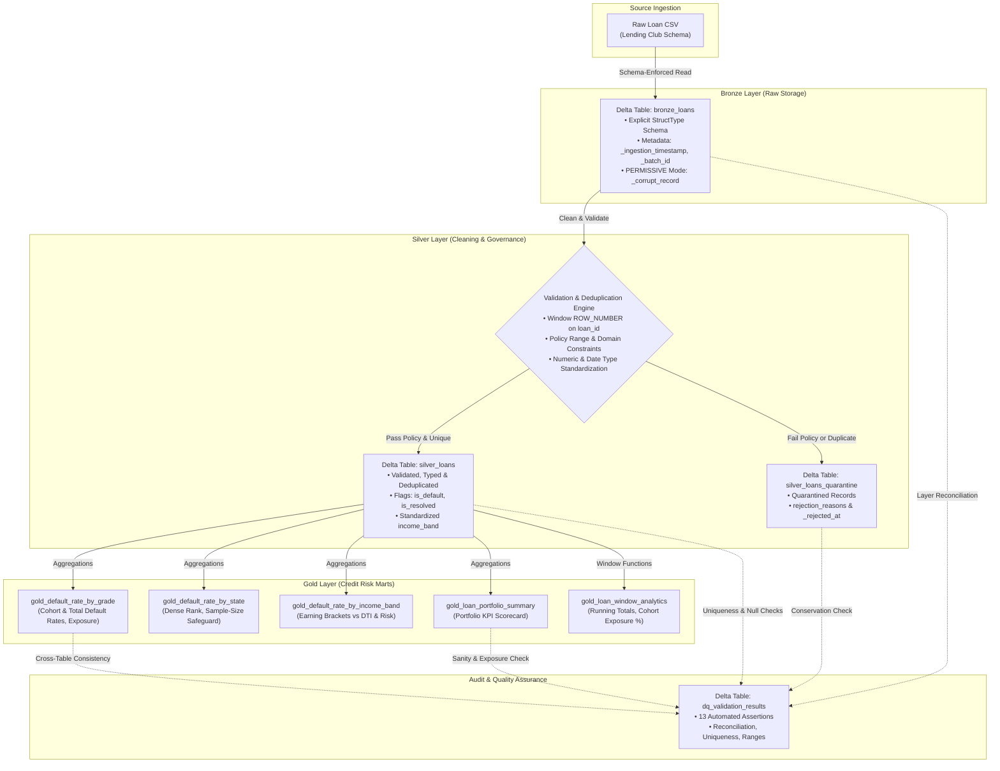

# Credit Risk Data Lakehouse — Azure Databricks & Delta Lake

[](https://www.python.org/)
[](https://spark.apache.org/)
[](https://delta.io/)
[](https://azure.microsoft.com/en-us/products/databricks/)
[](https://pytest.org/)

An end-to-end data engineering project implementing a **Credit Risk Data Lakehouse** on **Azure Databricks, PySpark, Spark SQL, and Delta Lake**. 

The project applies the **Medallion Architecture (Bronze $\rightarrow$ Silver $\rightarrow$ Gold)** to transform uncurated loan origination and performance records into verified credit risk analytical marts. It includes explicit schema enforcement, window-based deduplication, automated quarantine routing for anomalous records, an assertion-driven Data Quality framework, and portfolio risk metrics (cohort default rates, cumulative exposure, and state-level risk rankings).

---

## 1. Business Problem

In retail credit and peer-to-peer lending, evaluating credit portfolio performance, Probability of Default (PD), and Exposure at Default (EAD) requires reliable, auditable data pipelines aligned with risk governance practices (such as Basel II/III and CECL guidelines).

Raw loan data from origination feeds and third-party platforms often contains:
- Inconsistent types, formatting characters (`$`, `%`, whitespace), and malformed values.
- Duplicate submissions from upstream ingestion retries or batch overlaps.
- Invalid underwriting values (negative income, out-of-range loan amounts, corrupted credit grades).
- Misleading default calculations: Treating active loans (`Current`, `Late 16-30 days`, `In Grace Period`) as resolved outcomes artificially dilutes cohort default rates.

This pipeline solves these challenges by isolating raw ingestion, enforcing schema contracts, segregating non-compliant records into a quarantine table with auditable rejection reasons, and generating verified Gold analytical marts.

---

## 2. Key Features

- **Medallion Lakehouse Architecture:** Strict separation of concerns across Bronze (raw/append-only), Silver (cleaned/deduplicated), and Gold (business marts) using Delta Lake ACID storage.
- **Explicit Schema Enforcement:** All raw CSV ingestion uses predefined `StructType` schemas in `PERMISSIVE` mode to capture parsing anomalies in a dedicated `_corrupt_record` column without dropping records silently.
- **Window-Based Deduplication:** Resolves duplicates on the primary business key (`loan_id`) using `ROW_NUMBER() OVER (PARTITION BY loan_id ORDER BY _ingestion_timestamp DESC)`, preserving only the latest record while routing duplicates to quarantine.
- **Auditable Quarantine Table:** Anomalous records (negative amounts, invalid grades, missing identifiers) are segregated into `silver_loans_quarantine` with descriptive rejection reasons.
- **Credit Risk Analytical Marts:** Generates 5 business-ready Gold tables detailing loan default rates across grades A–G, geographic concentrations with sample-size safeguards, and income tiers.
- **Advanced SQL Window Analytics:** Computes chronological running totals, cumulative exposure, and cohort volume contribution percentages.
- **Automated Data Quality Framework:** Executes 13 assertions covering cross-table reconciliation, uniqueness, null checks, numeric ranges, domain integrity, and mathematical consistency.
- **Local & Cloud Portability:** Developed with modular Python modules (`src/`), Databricks-compatible notebooks (`notebooks/`), ANSI Spark SQL scripts (`sql/`), and unit tests (`tests/`).

---

## 3. Architecture & Data Flow



---

## 4. Technology Stack

| Component | Technology | Version | Purpose in Project |
| :--- | :--- | :--- | :--- |
| **Compute Engine** | Apache Spark / PySpark | 3.5.1 | Distributed data transformations, window aggregations, and pipeline execution. |
| **Storage & Table Format** | Delta Lake | 3.2.0 | ACID transaction support, atomic commits, and table schema evolution. |
| **Cloud Platform** | Azure Databricks | Runtime 14.3+ LTS | Target deployment environment for cloud orchestration and interactive notebooks. |
| **Runtime Language** | Python | 3.11.9 | Modular transformation pipelines, configuration loading, and orchestration. |
| **Relational Queries** | Spark SQL | ANSI-compliant | Declarative CTE cleaning scripts and Gold risk aggregation models. |
| **Testing** | pytest | 9.1.1 | Unit test suite for validation evaluators and business logic rules. |
| **Version Control** | Git & GitHub | — | Source control and version tracking for code and SQL models. |

---

## 5. Repository Structure

```
credit-risk-databricks/
├── README.md                           # Documentation, architecture, verified results
├── requirements.txt                    # Project Python dependencies
├── .gitignore                          # Standard ignores (caches, Delta outputs, temp files)
├── configs/
│   └── project_config.example.json     # Configuration template (Local & Unity Catalog paths)
├── data/
│   └── raw/
│       ├── generate_sample_data.py     # Reproducible synthetic raw data generator
│       └── loan_data_sample.csv        # Verifiable sample dataset with controlled anomalies
├── notebooks/
│   ├── 01_bronze_ingestion.py          # Databricks Notebook: Bronze raw ingestion
│   ├── 02_silver_transformations.py    # Databricks Notebook: Cleaning & quarantine routing
│   ├── 03_gold_risk_analytics.py       # Databricks Notebook: Credit risk analytical marts
│   └── 04_data_quality_checks.py       # Databricks Notebook: Data Quality scorecard & audit
├── src/
│   ├── __init__.py
│   ├── config.py                       # Configuration loader and table target mapper
│   ├── schemas.py                      # Explicit StructType schemas (Bronze, Silver, DQ)
│   ├── ingestion.py                    # Bronze ingestion with corrupt record capture
│   ├── transformations.py              # Silver cleaning, deduplication & quarantine logic
│   ├── risk_analytics.py               # Gold risk marts and window functions
│   ├── data_quality.py                 # Pure Python evaluators & PySpark DataQualityEngine
│   └── pipeline_runner.py              # End-to-end orchestration runner
├── sql/
│   ├── silver_cleaning.sql             # ANSI Spark SQL cleaning, deduplication & MERGE INTO
│   └── gold_analytics.sql              # ANSI Spark SQL analytical marts & window functions
├── tests/
│   ├── __init__.py
│   ├── test_data_quality.py            # Unit tests for pure DQ evaluators (pytest)
│   └── test_transformations.py         # Unit tests for business rules & income binning
└── docs/
    └── architecture.md                 # Detailed architectural and design specification
```

---

## 6. Dataset Source, Schema & Business Definitions

### 6.1. Dataset Source & Usage Restrictions
- **Source:** Kaggle Lending Club Loan Dataset ([Kaggle Lending Club](https://www.kaggle.com/c/lending-club/data)).
- **Development & Verification Fixture:** A representative, schema-identical CSV dataset (`data/raw/loan_data_sample.csv`, 995 rows) generated via `data/raw/generate_sample_data.py`. To rigorously exercise deduplication and quarantine routing, the dataset deliberately contains 14 duplicate records and 21 controlled anomaly records (negative amounts, out-of-bounds interest rates, invalid grades, and empty IDs).
- **License / Terms:** Open Data / CC0 Public Domain. Intended for development and educational demonstration.

### 6.2. Business Definition of Default
In consumer lending risk models, loan status indicates where a borrower sits in the repayment lifecycle:

- **Confirmed Default (`is_default = 1`):** Loans with status `Charged Off` or `Default`.
- **Resolved Outcome (`is_resolved = 1`):** Loans that have reached their terminal state (`Fully Paid`, `Charged Off`, `Default`).
- **Active / Unresolved (`is_resolved = 0`):** Loans actively servicing debt (`Current`, `In Grace Period`, `Late (16-30 days)`, `Late (31-120 days)`).

$$\text{Cohort Default Rate (\%)} = \frac{\sum \text{is\_default}}{\sum \text{is\_resolved}} \times 100$$

$$\text{Total Portfolio Default Rate (\%)} = \frac{\sum \text{is\_default}}{\text{Total Loans}} \times 100$$

*Rationale:* Evaluating default rates against only the resolved cohort reflects actual historical credit loss for mature loans, while total default rate reflects active portfolio exposure.

---

## 7. Medallion Layer Implementation

### 7.1. Bronze Layer (Raw Ingestion)
- **Delta Table:** `bronze_loans`
- **Schema:** 28 raw source fields defined explicitly in `BRONZE_RAW_SCHEMA` using `StringType` to ensure non-destructive ingestion.
- **Corrupt Record Handling:** `mode: PERMISSIVE` with `columnNameOfCorruptRecord: _corrupt_record`.
- **Audit Lineage Columns:**
  - `_ingestion_timestamp`: UTC timestamp of write.
  - `_source_file`: Source file path (`input_file_name()`).
  - `_batch_id`: Generated batch identifier (`batch_<timestamp>_<uuid>`).
- **Idempotency:** Parameterized write modes (`overwrite` for full refresh or partition replace on batch ID) avoid duplicate row accumulation on retries.

### 7.2. Silver Layer (Cleaning, Standardization & Quarantine)
- **Delta Tables:** `silver_loans` (Cleaned) and `silver_loans_quarantine` (Rejected).
- **Transformation & Cleaning Rules:**
  - Standardizes column names into lower snake_case (`loan_id`, `borrower_id`, `loan_amount`, `interest_rate_pct`, `annual_income`, etc.).
  - Strips formatting characters (`%`, `$`, commas, trailing spaces) and casts to `DoubleType`.
  - Parses loan duration strings (e.g. `' 36 months'`) to integer months (`36`, `60`).
  - Standardizes employment length strings (e.g. `'10+ years'`, `'< 1 year'`) to integers (`10`, `0`, `null`).
  - Standardizes issue dates into ISO first-of-month dates (`yyyy-MM-01`).
- **Deduplication Strategy:**
  - Deduplicates on business primary key `loan_id` using:
    ```sql
    ROW_NUMBER() OVER (PARTITION BY loan_id ORDER BY _ingestion_timestamp DESC) AS row_num
    ```
  - Records with `row_num = 1` that satisfy validation are retained. Records with `row_num > 1` are routed to quarantine with reason `DUPLICATE_LOAN_ID`.
- **Underwriting Policy & Quarantine Rules:**
  - `loan_id`: Must not be null or empty string (`NULL_OR_EMPTY_LOAN_ID`).
  - `loan_amount`: Must be between \$500.00 and \$100,000.00 (`INVALID_LOAN_AMOUNT`).
  - `annual_income`: Must be between \$1,000.00 and \$10,000,000.00 (`INVALID_ANNUAL_INCOME`).
  - `interest_rate_pct`: Must be between 0.0% and 100.0% (`INVALID_INTEREST_RATE`).
  - `loan_grade`: Must be one of `{'A', 'B', 'C', 'D', 'E', 'F', 'G'}` (`INVALID_LOAN_GRADE`).
  - `loan_status`: Must not be null or empty (`NULL_LOAN_STATUS`).
  - `_corrupt_record`: Must be null (`CORRUPT_RAW_RECORD`).
- **Enriched Risk Flags:**
  - `is_default` (0 or 1), `is_resolved` (0 or 1), and `income_band` (`1. Low (<$30k)`, `2. Lower-Middle ($30k-$60k)`, `3. Upper-Middle ($60k-$100k)`, `4. High ($100k-$150k)`, `5. Very High (>$150k)`).

### 7.3. Gold Layer (Credit Risk Marts)
The pipeline constructs 5 analytical marts saved as Delta tables:

1. **`gold_default_rate_by_grade`** (7 rows): Default rates and exposure metrics grouped by credit grade.
2. **`gold_default_rate_by_state`** (20 rows): Default rates by borrower state, with a minimum sample-size safeguard.
3. **`gold_default_rate_by_income_band`** (5 rows): Credit risk metrics and debt-to-income (DTI) distribution across income bands.
4. **`gold_loan_portfolio_summary`** (1 row): Executive-level KPI scorecard of portfolio performance.
5. **`gold_loan_window_analytics`** (153 rows): Advanced window functions tracking cumulative issuance and ranking across issue cohorts.

---

## 8. Verified Analytical Results

The following tables represent **actual outputs** from running the pipeline against the verified sample dataset:

### 8.1. Executive Portfolio Summary (`gold_loan_portfolio_summary`)
| Metric | Value |
| :--- | :--- |
| **Total Portfolio Loans** | 960 |
| **Total Exposure Amount** | \$17,788,500.00 |
| **Average Loan Amount** | \$18,529.69 |
| **Average Interest Rate** | 14.15% |
| **Overall Default Rate** | 18.23% (175 defaults / 960 total loans) |
| **Resolved Cohort Default Rate** | 25.74% (175 defaults / 680 resolved loans) |
| **Fully Paid Loans** | 505 |
| **Active Loans (Current/Late)** | 280 |
| **Total Payments Received** | \$16,883,376.00 |
| **Total Gross Recoveries** | \$51,308.79 |

### 8.2. Default Rate by Loan Grade (`gold_default_rate_by_grade`)
*Demonstrates a progressive risk gradient from Grade A through Grade G:*

| Loan Grade | Total Loans | Defaulted Loans | Cohort Default Rate | Total Default Rate | Total Exposure | Avg Interest Rate |
| :---: | :---: | :---: | :---: | :---: | :---: | :---: |
| **A** | 191 | 13 | 9.63% | 6.81% | \$3,418,800.00 | 7.28% |
| **B** | 269 | 30 | 16.13% | 11.15% | \$4,819,600.00 | 10.89% |
| **C** | 242 | 42 | 24.56% | 17.36% | \$4,532,900.00 | 14.49% |
| **D** | 127 | 35 | 37.23% | 27.56% | \$2,508,900.00 | 18.72% |
| **E** | 81 | 31 | 55.36% | 38.27% | \$1,439,000.00 | 23.22% |
| **F** | 29 | 13 | 56.52% | 44.83% | \$638,900.00 | 27.86% |
| **G** | 21 | 11 | 73.33% | 52.38% | \$430,400.00 | 32.72% |

### 8.3. Default Rate by Income Band (`gold_default_rate_by_income_band`)
| Income Band | Total Loans | Defaulted Loans | Default Rate | Total Exposure | Avg Loan Amount | Avg DTI Ratio |
| :--- | :---: | :---: | :---: | :---: | :---: | :---: |
| **1. Low (<$30k)** | 4 | 2 | 50.00% | \$62,700.00 | \$15,675.00 | 29.80 |
| **2. Lower-Middle ($30k-$60k)** | 194 | 37 | 19.07% | \$3,691,000.00 | \$19,025.77 | 20.03 |
| **3. Upper-Middle ($60k-$100k)** | 434 | 70 | 16.13% | \$7,986,400.00 | \$18,401.84 | 21.79 |
| **4. High ($100k-$150k)** | 280 | 59 | 21.07% | \$5,167,600.00 | \$18,455.71 | 21.83 |
| **5. Very High (>$150k)** | 48 | 7 | 14.58% | \$880,800.00 | \$18,350.00 | 23.30 |

### 8.4. Top 5 States by Risk with Minimum Sample Safeguard (`gold_default_rate_by_state`)
*Ranks states using `DENSE_RANK()`, with a minimum sample-size safeguard (`total_loans >= 10`):*

| State | Total Loans | Defaulted Loans | Default Rate | Total Exposure | Avg Annual Income | Sample Safeguard Met | State Risk Rank |
| :---: | :---: | :---: | :---: | :---: | :---: | :---: | :---: |
| **NJ** | 51 | 14 | 27.45% | \$891,100.00 | \$94,374.51 | True | 1 |
| **CA** | 48 | 12 | 25.00% | \$1,033,900.00 | \$87,206.25 | True | 2 |
| **MI** | 54 | 13 | 24.07% | \$1,015,700.00 | \$85,329.63 | True | 3 |
| **PA** | 46 | 10 | 21.74% | \$891,300.00 | \$79,523.91 | True | 4 |
| **NC** | 47 | 10 | 21.28% | \$908,400.00 | \$92,797.87 | True | 5 |

---

## 9. Data Quality Assertions & Audit Results

The Data Quality Engine executes **13 automated assertions** across all pipeline layers, storing audit results in `dq_validation_results`:

| Assertion Check Name | Target Table | Check Type | Status | Severity | Observed Value | Expected Threshold |
| :--- | :--- | :--- | :---: | :---: | :--- | :--- |
| `bronze_source_reconciliation` | `bronze_loans` | Reconciliation | **PASS** | CRITICAL | 995 rows | 995 rows |
| `bronze_corrupt_records_threshold` | `bronze_loans` | Data Integrity | **PASS** | WARNING | 0 (0.0%) | $\le 1.0\%$ |
| `silver_record_conservation_reconciliation` | `silver_loans` | Reconciliation | **PASS** | CRITICAL | Accepted(960) + Quarantine(35) = 995 | Bronze Count = 995 |
| `silver_loan_id_uniqueness` | `silver_loans` | Uniqueness | **PASS** | CRITICAL | Distinct=960, Total=960 | 0 duplicates |
| `silver_null_check_loan_id` | `silver_loans` | Null Check | **PASS** | CRITICAL | 0 nulls (0.0%) | 0.0% nulls |
| `silver_null_check_loan_amount` | `silver_loans` | Null Check | **PASS** | CRITICAL | 0 nulls (0.0%) | 0.0% nulls |
| `silver_null_check_annual_income` | `silver_loans` | Null Check | **PASS** | CRITICAL | 0 nulls (0.0%) | 0.0% nulls |
| `silver_null_check_interest_rate_pct` | `silver_loans` | Null Check | **PASS** | CRITICAL | 0 nulls (0.0%) | 0.0% nulls |
| `silver_null_check_loan_grade` | `silver_loans` | Null Check | **PASS** | CRITICAL | 0 nulls (0.0%) | 0.0% nulls |
| `silver_null_check_loan_status` | `silver_loans` | Null Check | **PASS** | CRITICAL | 0 nulls (0.0%) | 0.0% nulls |
| `silver_range_check_loan_amount` | `silver_loans` | Range Check | **PASS** | CRITICAL | [\$2,000.0, \$35,000.0] | [\$500.0, \$100,000.0] |
| `silver_domain_check_loan_grade` | `silver_loans` | Domain Check | **PASS** | CRITICAL | ['A', 'B', 'C', 'D', 'E', 'F', 'G'] | Subset of valid grades |
| `gold_portfolio_default_rate_sanity` | `gold_analytics` | Sanity Check | **PASS** | WARNING | 18.23% | [1.0%, 60.0%] |
| `gold_exposure_cross_table_consistency` | `gold_analytics` | Consistency | **PASS** | CRITICAL | GradeSum=\$17.7885M, Port=\$17.7885M | $\Delta \le \$0.05$ |

---

## 10. Sample SQL Queries

The repository includes standalone SQL scripts in [`sql/`](sql/) that mirror the PySpark transformations:

### 10.1. Deduplication and Cleaning CTE ([sql/silver_cleaning.sql](sql/silver_cleaning.sql))
```sql
WITH bronze_typed AS (
    SELECT
        TRIM(id) AS loan_id,
        CAST(REGEXP_REPLACE(TRIM(loan_amnt), '[%,\\$ ]', '') AS DOUBLE) AS loan_amount,
        UPPER(TRIM(grade)) AS loan_grade,
        TRIM(loan_status) AS loan_status,
        _ingestion_timestamp
    FROM bronze_loans
),
bronze_ranked AS (
    SELECT
        *,
        ROW_NUMBER() OVER (
            PARTITION BY loan_id 
            ORDER BY _ingestion_timestamp DESC
        ) AS row_num
    FROM bronze_typed
)
SELECT *
FROM bronze_ranked
WHERE row_num = 1
  AND loan_id IS NOT NULL
  AND loan_amount BETWEEN 500.0 AND 100000.0;
```

### 10.2. Window Functions: Cumulative Issuance & Cohort Contribution ([sql/gold_analytics.sql](sql/gold_analytics.sql))
```sql
SELECT
    loan_grade,
    issue_month,
    monthly_loans_issued,
    monthly_exposure_issued,
    -- Running cumulative exposure per loan grade
    ROUND(SUM(monthly_exposure_issued) OVER (
        PARTITION BY loan_grade 
        ORDER BY issue_month 
        ROWS BETWEEN UNBOUNDED PRECEDING AND CURRENT ROW
    ), 2) AS cumulative_exposure_issued,
    -- Cohort percent contribution to lifetime grade volume
    ROUND(
        monthly_exposure_issued / SUM(monthly_exposure_issued) OVER (PARTITION BY loan_grade) * 100,
        2
    ) AS monthly_exposure_pct_of_grade
FROM monthly_grade_cohorts
ORDER BY loan_grade ASC, issue_month ASC;
```

---

## 11. Local Setup & Testing

### 11.1. Prerequisites
- Python 3.10 or 3.11
- Java Development Kit (JDK 11 or 17)
- Winutils (Hadoop 3.3.x binaries) if running on Windows

### 11.2. Installation & Test Execution
```bash
# 1. Clone repository
git clone https://github.com/<your-username>/credit-risk-databricks.git
cd credit-risk-databricks

# 2. Install dependencies
python -m pip install -r requirements.txt

# 3. Run unit tests
pytest -v
```

**Unit Test Output (20 passed in 0.26s):**
```
tests/test_data_quality.py::TestNullPercentageEvaluator::test_null_percentage_pass PASSED
tests/test_data_quality.py::TestNullPercentageEvaluator::test_null_percentage_fail PASSED
tests/test_data_quality.py::TestNullPercentageEvaluator::test_null_percentage_warning PASSED
tests/test_data_quality.py::TestNullPercentageEvaluator::test_null_percentage_zero_total PASSED
tests/test_data_quality.py::TestUniquenessEvaluator::test_uniqueness_pass PASSED
tests/test_data_quality.py::TestUniquenessEvaluator::test_uniqueness_fail PASSED
tests/test_data_quality.py::TestNumericRangeEvaluator::test_range_pass PASSED
tests/test_data_quality.py::TestNumericRangeEvaluator::test_range_fail_below_min PASSED
tests/test_data_quality.py::TestNumericRangeEvaluator::test_range_fail_above_max PASSED
tests/test_data_quality.py::TestCategoricalDomainEvaluator::test_domain_pass PASSED
tests/test_data_quality.py::TestCategoricalDomainEvaluator::test_domain_fail PASSED
tests/test_data_quality.py::TestReconciliationEvaluator::test_reconciliation_exact_pass PASSED
tests/test_data_quality.py::TestReconciliationEvaluator::test_reconciliation_variance_fail PASSED
tests/test_data_quality.py::TestDefaultRateSanityEvaluator::test_sanity_pass PASSED
tests/test_data_quality.py::TestDefaultRateSanityEvaluator::test_sanity_fail_unrealistic_high PASSED
tests/test_data_quality.py::TestDefaultRateSanityEvaluator::test_sanity_fail_unrealistic_low PASSED
tests/test_transformations.py::test_business_rules_default_values PASSED
tests/test_transformations.py::test_income_band_classification PASSED
tests/test_transformations.py::test_credit_risk_default_logic PASSED
tests/test_transformations.py::test_config_loader PASSED
```

### 11.3. Running the Pipeline Locally
```bash
python -m src.pipeline_runner --config configs/project_config.example.json
```

---

## 12. Azure Databricks Deployment & Configuration

### 12.1. Workspace Setup
1. In Databricks, navigate to **Workspace $\rightarrow$ Repos** and import this repository.
2. Create a cluster:
   - **Runtime:** Databricks Runtime 14.3 LTS or 15.4 LTS (includes Apache Spark 3.5, Delta Lake 3.x).
   - **Node Type:** Single Node cluster (`Standard_D4ds_v5`) to minimize compute cost.
   - **Auto-Termination:** Set to 20 minutes.

### 12.2. Unity Catalog Configuration
To use Databricks Unity Catalog, modify `configs/project_config.example.json`:
```json
{
  "environment": "databricks",
  "unity_catalog": {
    "enabled": true,
    "catalog_name": "credit_risk_catalog",
    "bronze_schema": "bronze",
    "silver_schema": "silver",
    "gold_schema": "gold",
    "tables": {
      "bronze_loans": "credit_risk_catalog.bronze.loans",
      "silver_loans": "credit_risk_catalog.silver.loans",
      "silver_quarantine": "credit_risk_catalog.silver.loans_quarantine",
      "gold_default_by_grade": "credit_risk_catalog.gold.default_rate_by_grade",
      "gold_default_by_state": "credit_risk_catalog.gold.default_rate_by_state",
      "gold_default_by_income_band": "credit_risk_catalog.gold.default_rate_by_income_band",
      "gold_portfolio_summary": "credit_risk_catalog.gold.loan_portfolio_summary",
      "gold_window_analytics": "credit_risk_catalog.gold.loan_window_analytics",
      "dq_validation_results": "credit_risk_catalog.gold.dq_validation_results"
    }
  }
}
```

### 12.3. Workflow Orchestration
Run the notebooks sequentially via a Databricks Multi-Task Job:
1. `notebooks/01_bronze_ingestion.py`
2. `notebooks/02_silver_transformations.py`
3. `notebooks/03_gold_risk_analytics.py`
4. `notebooks/04_data_quality_checks.py`

---

## 13. Cost Optimization & Troubleshooting

### Cost Optimization Guidance
- **Single Node Clusters for Development:** Avoid multi-worker clusters during ETL development; a single `Standard_D4ds_v5` node handles development datasets efficiently.
- **Spot Instances:** For batch workloads in staging or production, configure worker instances to utilize Azure Spot VMs (up to 70% cost reduction).
- **Delta Table Maintenance:**
  ```sql
  -- Consolidate small files
  OPTIMIZE silver_loans ZORDER BY (loan_grade, issue_date);
  -- Clean unreferenced historical files older than 7 days
  VACUUM silver_loans RETAIN 168 HOURS;
  ```

### Troubleshooting
- **Missing Winutils on Windows:** Spark requires `winutils.exe` and `hadoop.dll` in `%HADOOP_HOME%\bin` for local file writes on Windows.
- **Delta Spark JVM Initialization:** When running PySpark scripts outside Databricks, initialize Delta with `from delta import configure_spark_with_delta_pip`.

---

## 14. Assumptions, Limitations & Future Improvements

### Assumptions & Limitations
- **Development Dataset Size:** Local development and unit tests use a schema-compliant sample of 995 records rather than the full multi-GB Lending Club dataset to enable quick test turnaround.
- **Static Interest Rate Parsing:** Assumes interest rate percentages are either formatted as string percentages (e.g. `12.5%`) or raw floats.

### Future Improvements (TODOs)
- [ ] **Delta Live Tables (DLT):** Migrate the pipeline notebooks to Delta Live Tables with native `@dlt.table` and `@dlt.expect_or_drop` expectations.
- [ ] **Databricks Asset Bundles (DABs):** Package configuration and workflows into DABs for CI/CD deployments via GitHub Actions.
- [ ] **Liquid Clustering:** Benchmark Databricks Liquid Clustering (`CLUSTER BY (loan_grade, borrower_state)`) against traditional Hive partitioning on large multi-million record volumes.
