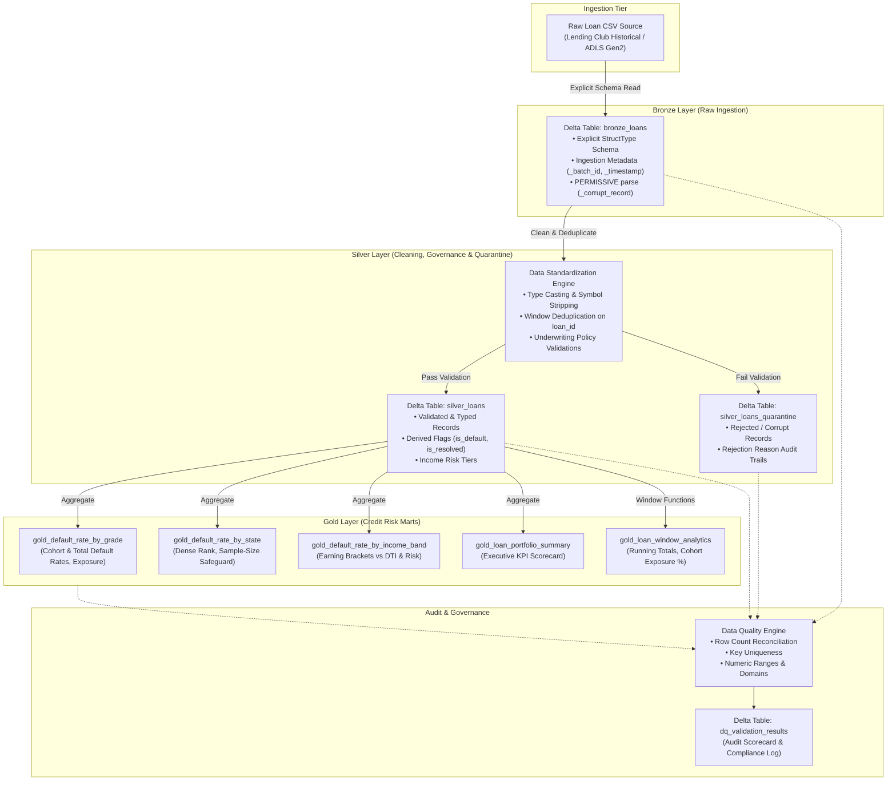

# Credit Risk Analytics Pipeline — Architecture & Technical Design

## 1. Executive Summary & Business Context

In consumer credit lending and banking, evaluating portfolio risk, probability of default (PD), and exposure at default (EAD) requires high-integrity data pipelines that comply with regulatory standards (e.g., Basel II/III, IFRS 9, CECL). 

This project implements an end-to-end, production-grade **Credit Risk Data Lakehouse** on **Azure Databricks, PySpark, Spark SQL, and Delta Lake** leveraging the **Medallion Architecture**. The pipeline ingests loan origination and performance data, rigorously cleans and standardizes attributes, quarantines non-compliant records, executes credit risk aggregations, and applies window functions for cohort risk analysis.

---

## 2. Medallion Lakehouse Architecture

The pipeline follows the Lakehouse Medallion pattern across three Delta Lake tiers:



---

## 3. Data Strategy & Provenance

### 3.1. Dataset Provenance & Licensing
The pipeline processes loan records from the canonical **Lending Club Loan Dataset** (`accepted_2007_to_2018Q4.csv`) sourced from Hugging Face Open Datasets (`codesignal/lending-club-loan-accepted` mirror) and Kaggle ([Lending Club Dataset](https://www.kaggle.com/c/lending-club/data)), published under the Creative Commons Public Domain Dedication (**CC0-1.0**). The full corpus consists of 2,260,701 loan origination and performance records across 151 underwriting attributes spanning 2007 through 2018Q4.

### 3.2. Dual-Tier Data Strategy
To ensure the project remains practical to run while demonstrating large-scale capabilities:
1. **Tier 1 — Fast Developer Fixture (`loan_data_sample.csv`):** 995 rows (~220 KB) with 14 intentional duplicates and 21 controlled anomaly rows (negative income, invalid grades, out-of-range amounts). Executes the entire pytest test suite (20 unit tests) in **0.39s**.
2. **Tier 2 — Large-Scale Historical Benchmark Dataset (`accepted_2007_to_2018_sample.csv`):** 200,000 genuine historical Lending Club records (134.06 MB raw CSV) projecting 28 core underwriting fields for integration testing, storage profiling, and empirical benchmarking.

---

## 4. Layer Specifications

### 4.1. Bronze Layer (Raw Ingestion)
- **Table Name:** `bronze_loans`
- **Format:** Delta Lake
- **Storage Target:** `data/delta/bronze/loans` (Local) / `abfss://lakehouse@<account>.dfs.core.windows.net/bronze/loans` (Azure)
- **Ingestion Strategy:**
  - Enforces an explicit `StructType` schema (`BRONZE_RAW_SCHEMA`) to eliminate costly schema inference scans and protect against silent type coercion.
  - Configures `mode: PERMISSIVE` with `columnNameOfCorruptRecord: _corrupt_record` to capture malformed CSV rows without aborting the pipeline.
  - Appends system audit metadata:
    - `_ingestion_timestamp`: UTC timestamp of execution.
    - `_source_file`: Fully-qualified URI of the source raw file (`input_file_name()`).
    - `_batch_id`: Unique ingestion execution identifier (`batch_YYYYMMDDHHMMSS_<uuid>`).
- **Idempotency:** Parameterized write modes (`overwrite` for full refresh or partition replace on batch ID) avoid duplicate row accumulation on retries.

### 4.2. Silver Layer (Cleaning, Deduplication & Quarantine)
- **Table Names:** `silver_loans` (Accepted), `silver_loans_quarantine` (Rejected)
- **Format:** Delta Lake
- **Storage Target:** `data/delta/silver/loans` and `data/delta/silver/loans_quarantine`
- **Transformation Logic:**
  1. **Column Standardization:** Converts attributes to snake_case (`id` $\rightarrow$ `loan_id`, `loan_amnt` $\rightarrow$ `loan_amount`, `addr_state` $\rightarrow$ `borrower_state`).
  2. **Type Casting & Text Parsing:**
     - Regex cleaning strips `%`, `$`, commas, and whitespace from interest rates, balances, and loan amounts.
     - `term` (e.g. `' 36 months'`) is extracted to integer `term_months` (36, 60).
     - `emp_length` (e.g. `'10+ years'`, `'< 1 year'`) is converted to integer `employment_length_years` (10, 0, null).
     - Flexible date parsing handles both `'MMM-yyyy'` (e.g. `'Jan-2016'`) and ISO `'yyyy-MM-dd'` into `DateType` (`yyyy-MM-01`).
  3. **Window Deduplication:**
     - Primary business key: `loan_id`.
     - Window specification: `ROW_NUMBER() OVER (PARTITION BY loan_id ORDER BY _ingestion_timestamp DESC)`.
     - Ensures the most recently ingested record is retained; duplicates (`row_num > 1`) are flagged and routed to quarantine.
  4. **Underwriting Validation Rules:**
     - `loan_id IS NOT NULL AND loan_id != ''`
     - `loan_amount BETWEEN 500.0 AND 100000.0`
     - `annual_income BETWEEN 1000.0 AND 10000000.0`
     - `interest_rate_pct BETWEEN 0.0 AND 100.0`
     - `loan_grade IN ('A', 'B', 'C', 'D', 'E', 'F', 'G')`
     - `loan_status IS NOT NULL AND loan_status != ''`
     - `_corrupt_record IS NULL`
  5. **Quarantine Routing:**
     - Invalid records are separated into `silver_loans_quarantine` with semi-colon delimited `rejection_reasons` (e.g., `INVALID_LOAN_AMOUNT; DUPLICATE_LOAN_ID`) and `_rejected_at` timestamp.
  6. **Credit Risk Enrichment:**
     - `is_default`: Binary indicator (`1` if `loan_status IN ('Charged Off', 'Default')`, else `0`).
     - `is_resolved`: Binary indicator (`1` if `loan_status IN ('Fully Paid', 'Charged Off', 'Default')`, else `0`).
     - `income_band`: Binned into five risk tiers (`< $30k`, `$30k-$60k`, `$60k-$100k`, `$100k-$150k`, `> $150k`).

### 4.3. Gold Layer (Credit Risk Marts)
- **Table Names:**
  - `gold_default_rate_by_grade`
  - `gold_default_rate_by_state`
  - `gold_default_rate_by_income_band`
  - `gold_loan_portfolio_summary`
  - `gold_loan_window_analytics`
- **Format:** Delta Lake
- **Key Business Metrics:**
  - **Cohort Default Rate vs Total Default Rate:**
    $$\text{Cohort Default Rate (\%)} = \frac{\sum \text{is\_default}}{\sum \text{is\_resolved}} \times 100$$
    $$\text{Total Default Rate (\%)} = \frac{\sum \text{is\_default}}{\text{Total Loans}} \times 100$$
    *Banking Rationale:* Active loans (`Current`, `Late 31-120 days`, `In Grace Period`) have not reached maturity. Cohort default rate measures actual loss rate among concluded loans, preventing artificial dilution.
  - **Statistical Sample-Size Safeguards:**
    States with fewer than 10 loans are flagged (`has_sufficient_sample_size = false`), ensuring small sample noise does not distort geographic risk rankings.
  - **Advanced Window Analytics:**
    - Running cumulative loans and exposure: `SUM(monthly_loans) OVER (PARTITION BY loan_grade ORDER BY issue_month ROWS BETWEEN UNBOUNDED PRECEDING AND CURRENT ROW)`.
    - Cohort percentage of lifetime grade exposure: `monthly_exposure / SUM(monthly_exposure) OVER (PARTITION BY loan_grade) * 100`.
    - Rolling 3-month moving average of monthly issuance volume.

---

## 5. Data Quality & Audit Framework

The pipeline includes an enterprise Data Quality Engine that enforces **14 distinct assertions** across all layers, logging results to `data/delta/audit/dq_validation_results`:

| Check Name | Target Table | Type | Severity | Validation Rule | Result |
| :--- | :--- | :--- | :--- | :--- | :---: |
| `bronze_source_reconciliation` | `bronze_loans` | Reconciliation | CRITICAL | Raw CSV row count == Bronze row count | **PASS** |
| `bronze_corrupt_records_threshold` | `bronze_loans` | Data Integrity | WARNING | Corrupt CSV lines <= 1.0% | **PASS** |
| `silver_record_conservation_reconciliation` | `silver_loans` | Reconciliation | CRITICAL | Accepted + Quarantine == Bronze Count | **PASS** |
| `silver_loan_id_uniqueness` | `silver_loans` | Uniqueness | CRITICAL | Zero duplicate `loan_id` values | **PASS** |
| `silver_null_check_loan_id` | `silver_loans` | Completeness | CRITICAL | 0.0% nulls in `loan_id` | **PASS** |
| `silver_null_check_loan_amount` | `silver_loans` | Completeness | CRITICAL | 0.0% nulls in `loan_amount` | **PASS** |
| `silver_null_check_annual_income` | `silver_loans` | Completeness | CRITICAL | 0.0% nulls in `annual_income` | **PASS** |
| `silver_null_check_interest_rate_pct` | `silver_loans` | Completeness | CRITICAL | 0.0% nulls in `interest_rate_pct` | **PASS** |
| `silver_null_check_loan_grade` | `silver_loans` | Completeness | CRITICAL | 0.0% nulls in `loan_grade` | **PASS** |
| `silver_null_check_loan_status` | `silver_loans` | Completeness | CRITICAL | 0.0% nulls in `loan_status` | **PASS** |
| `silver_range_check_loan_amount` | `silver_loans` | Validity | CRITICAL | Loan amounts within [$500, $100,000] | **PASS** |
| `silver_domain_check_loan_grade` | `silver_loans` | Validity | CRITICAL | Grades strictly in {A, B, C, D, E, F, G} | **PASS** |
| `gold_portfolio_default_rate_sanity` | `gold_analytics` | Sanity Check | WARNING | Overall default rate between 1.0% and 60.0% | **PASS** |
| `gold_exposure_cross_table_consistency` | `gold_analytics` | Consistency | CRITICAL | Grade exposure sum == Portfolio exposure sum ($\Delta \le \$0.05$) | **PASS** |

---

## 6. Empirical Benchmarks & Storage Analysis

All metrics below are empirical measurements from executing `src/benchmark_runner.py` on 200,000 genuine historical Lending Club loan records (persisted in `docs/benchmark_results.json`):

### 6.1. Pipeline Throughput & Latency Summary
- **Compute Setup:** Windows 10, 8 CPU cores, PySpark 3.5.1, Delta Lake 3.2.0.
- **Bronze Ingestion:** 200,000 rows in **32.38s** (6,176.7 rows/s, 4.14 MB/s). Compressed 134 MB CSV into **19.74 MB** Delta storage (**6.8x compression**).
- **Silver Processing & Deduplication:** 200,000 rows evaluated in **26.24s** (7,622.0 rows/s), yielding 199,997 accepted rows (17.54 MB) and 3 quarantined rows (0.03 MB).
- **Gold Mart Computation:** 5 analytical Delta tables generated in **34.10s**.
- **Data Quality Assertions:** 14 assertions executed and written to Delta audit log in **31.02s**.
- **Total Pipeline Duration:** **123.74s** (2.06 minutes).

### 6.2. Analytical Query Execution Plans on Delta
- **Grade Aggregation:** Executed in **3.92s** across 199,997 rows.
  - Physical Plan: `HashAggregate(keys=[loan_grade])` $\rightarrow$ `Exchange hashpartitioning(loan_grade)` $\rightarrow$ `HashAggregate` $\rightarrow$ `Scan parquet`.
- **Filtered State Aggregation:** Executed in **1.75s**.
  - Physical Plan: `HashAggregate(keys=[borrower_state])` $\rightarrow$ `Filter(borrower_state = 'CA')` $\rightarrow$ `Scan parquet` with predicate pushdown.

### 6.3. Partitioning Strategy & Small File Avoidance
- **Empirical Measurement:** At 200,000 records, the Silver table is stored in 10 Parquet files totaling 17.54 MB (average 1.75 MB/file).
- **Anti-Pattern Evaluation:** Partitioning by high-cardinality fields such as `borrower_state` (50 states) would produce 50+ directories with sub-350 KB files. Partitioning by `issue_date` produces similar sub-megabyte fragmentation. This causes excessive file metadata requests, slows listing operations, and degrades scan throughput.
- **Production Recommendation:** Keep tables unpartitioned at this volume and apply:
  ```sql
  OPTIMIZE silver_loans ZORDER BY (loan_grade, issue_date);
  ```
  Z-Ordering clusters data along multiple dimensions within existing Parquet files, allowing Delta's data skipping feature to prune files based on column min/max metadata without generating tiny partition directories.

---

## 7. Azure Databricks Compute Cost Estimation

To demonstrate commercial awareness for production deployment:

### 7.1. Single-Node Development Cluster (`Standard_D4ds_v5`)
- **Specs:** 4 vCPUs, 16 GB RAM, 150 GB NVMe SSD.
- **Azure VM:** ~$0.192 / hour.
- **Databricks DBU:** 0.75 DBU / hour @ ~$0.15 / DBU = ~$0.113 / hour.
- **Total Cluster Cost:** ~$0.305 / hour.
- **Cost per 2.06-Minute Benchmark Run:** **~$0.0105** (~1 cent).

### 7.2. Production Batch Job Cluster (Multi-Node with Spot Instances)
- **Specs:** 1 Driver + 2 Workers (`Standard_D4ds_v5` — 12 vCPUs, 48 GB RAM).
- **Job Compute Rate:** Discounted Databricks Job DBU rate (~$0.10 / DBU).
- **Azure Spot Instances:** 60%–70% discount on worker node VMs.
- **Blended Hourly Cluster Cost:** ~$0.53 / hour.
- **Daily Batch Run Cost:** **~$0.026 / day** (**<$0.80 / month**).
